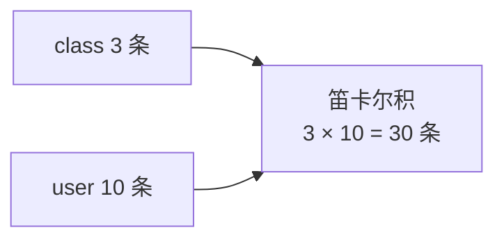

**授课目标**：从单行数据的查询过渡到宏观数据的统计分析。熟练掌握**五大核心聚合函数**，深刻理解 `GROUP BY` 按条件分组的底层逻辑，并开启多表查询的理论大门，通过"**笛卡尔积**"演示理解多表关联时数据量爆炸的风险。

## 一、核心聚合函数：宏观数据统计

在报表开发与数据分析中，我们经常需要对整张表或符合条件的数据集进行数学运算，而非仅仅把它们列出来。此时需要使用 MySQL 的聚合函数。

### 1. 统计个数：COUNT()

```sql
-- 统计 user 表的总行数 (推荐使用 COUNT(*))
SELECT COUNT(*) FROM user;

-- 统计特定字段有值的行数 (忽略 NULL 值)
SELECT COUNT(id) FROM user;

-- 统计符合特定条件的行数 (id大于2的用户数)
SELECT COUNT(*) FROM user WHERE id>2;
```

> [!important] `COUNT(*)` vs `COUNT(col)` vs `COUNT(1)`（面试高频）
> | 写法 | 行为 | 说明 |
> | :--- | :--- | :--- |
> | **`COUNT(*)`** | 统计**所有行**（含 NULL） | **InnoDB 有专门优化，最快** |
> | `COUNT(1)` | 统计**所有行** | 与 `COUNT(*)` 几乎等价 |
> | `COUNT(col)` | **跳过该列为 NULL 的行** | 要判断每行是否 NULL，**更慢** |
>
> **结论：统计总行数用 `COUNT(*)`。**

### 2. 求和与平均值：SUM() 与 AVG()

**只能用于数值型字段。**

```sql
-- 计算所有用户 id 的总和
SELECT SUM(id) FROM user;

-- 计算所有用户 id 的平均值
SELECT AVG(id) FROM user;
```

> [!warning] SUM / AVG 会**忽略 NULL**
> ```sql
> -- 假设 balance 有 3 行：100、NULL、300
> SELECT AVG(balance) FROM t;   -- 结果是 200，不是 133.3
> -- 因为分母是 2（跳过了 NULL），不是 3
> ```
> 如果 NULL 应该算 0，用 `AVG(IFNULL(balance,0))`。

### 3. 极值统计：MAX() 与 MIN()

```sql
-- 提取最大 id 和最小 id
SELECT MAX(id), MIN(id) FROM user;
```

### 五大聚合函数总结

| 函数 | 作用 | 是否忽略 NULL |
| :--- | :--- | :---: |
| **`COUNT()`** | 统计个数 | `COUNT(*)` 不忽略；`COUNT(col)` 忽略 |
| **`SUM()`** | 求和 | ✅ 忽略 |
| **`AVG()`** | 求平均 | ✅ 忽略 |
| **`MAX()`** | 最大值 | ✅ 忽略 |
| **`MIN()`** | 最小值 | ✅ 忽略 |

## 二、环境准备：构建多表关联与分组测试数据

为了完美演示接下来的分组与多表理论，我们需要重构并扩展数据表，建立 `class`（班级表）与 `user`（学员表）的业务关联逻辑。

### 1. 创建 class 表并插入数据

```sql
CREATE TABLE class(
    id int unsigned auto_increment primary key,
    name varchar(30) not null,
    ctime int unsigned not null
) ENGINE=InnoDB DEFAULT CHARSET=utf8mb4;

-- 插入 3 个班级的数据，ctime 使用时间戳
INSERT INTO class(id, name, ctime) VALUES
(1, 'class1', 1492086867),
(2, 'class2', 1492086867),
(3, 'class3', 1492086867);
```

### 2. 重建带有 class_id（外键逻辑）的 user 表

```sql
-- 覆盖重建 user 表，新增 age 和 class_id 字段
DROP TABLE IF EXISTS user;
CREATE TABLE user(
    id int unsigned auto_increment primary key,
    username varchar(50) not null,
    age tinyint unsigned not null,
    class_id int unsigned not null
) ENGINE=InnoDB DEFAULT CHARSET=utf8mb4;

-- 批量插入 10 名学员数据，并分配到不同的班级
INSERT INTO user(id, username, age, class_id) VALUES
(1, 'user1', 19, 1),
(2, 'user2', 19, 1),
(3, 'user3', 19, 1),
(4, 'user4', 19, 1),
(5, 'user5', 19, 2),
(6, 'user6', 19, 3),
(7, 'user7', 19, 2),
(8, 'user8', 19, 1),
(9, 'user9', 19, 2),
(10, 'user10', 19, 3);
```

## 三、分组聚合查询 (GROUP BY)

**`GROUP BY` 的核心思想是：按条件进行分组，然后在分组的基础上进行有条件的聚合。**

### 1. 基础分组特性剖析

如果只使用 `GROUP BY` 而不加聚合函数，**分组结果中每个分组只会返回一条记录**。

> [!danger] MySQL 8.0 默认开启 `ONLY_FULL_GROUP_BY` 严格模式（重要）
> `SELECT` 列表中出现的字段**必须与 `GROUP BY` 分组列一致**（或使用聚合函数），**否则会直接报错**。

```sql
-- 仅按 class_id 分组，不带聚合函数时每组只返回一条记录（去重效果）
SELECT class_id FROM user GROUP BY class_id;
```

> [!warning] 这个严格模式救了很多 bug
> 在 MySQL 5.7 之前，`SELECT username, COUNT(*) FROM user GROUP BY class_id` 是**不报错的**，但 `username` 返回的是**组内随机一行**，结果不可预测。
>
> MySQL 8.0 默认报错，强制你写清楚。
>
> 查看当前设置：
> ```sql
> SELECT @@sql_mode;
> ```

### 2. 分组统计实战

结合聚合函数，我们就能得出**极具商业价值的数据**。

```sql
-- 核心实战：统计每个班级的总人数
SELECT class_id, COUNT(*) FROM user GROUP BY class_id;

-- 进阶格式化输出：结合上节课学的 CONCAT 拼接函数
SELECT CONCAT(class_id, ' 班') AS 班级, CONCAT(COUNT(*), ' 人') AS 人数 FROM user GROUP BY class_id;

-- 终极综合分组：统计每个班级的最大ID、最小ID、总人数、ID总和及平均ID
SELECT class_id, MAX(id), MIN(id), COUNT(*), SUM(id), AVG(id) FROM user GROUP BY class_id;
```

### GROUP BY 配合 HAVING 过滤分组

> [!important] `WHERE` vs `HAVING`（高频考点，记住）
> | 子句 | 作用对象 | 执行时机 | 能否用聚合函数 |
> | :--- | :--- | :--- | :---: |
> | **`WHERE`** | **原始行** | **分组前** | ❌ **不能** |
> | **`HAVING`** | **分组后** | **分组后** | ✅ **能** |

```sql
-- 查询人数大于 2 的班级
SELECT class_id, COUNT(*) AS tot FROM user GROUP BY class_id HAVING tot > 2;

-- 完整写法：先 WHERE 过滤行，再 GROUP BY，再 HAVING 过滤组，最后 ORDER BY
SELECT class_id, COUNT(*) AS tot
FROM user
WHERE age >= 18
GROUP BY class_id
HAVING tot >= 2
ORDER BY tot DESC;
```

### SQL 语句执行顺序


**记住这个顺序，很多"为什么不能用别名"的疑问就通了**：`SELECT` 在 `WHERE` **之后**执行，所以 **`WHERE` 里不能用 `SELECT` 定义的别名**，但 **`ORDER BY` 可以用**。

## 四、多表查询设计基础与笛卡尔积

在真实企业项目中，数据**永远不会只存在一张表里**，而是通过**主键 (Primary Key)** 与**外键 (Foreign Key)** 的逻辑关联分散在多张表中。

如我们刚刚创建的：`class.id` 是班级表**主键**，`user.class_id` 是关联该班级的**逻辑外键**。

### 1. 无条件查询与数据爆炸（笛卡尔积）

```sql
-- 查询 class 与 user 两张表的所有数据组合
SELECT * FROM class, user;
```

> [!danger] 观察巨大的输出结果集，两个核心结论（记住）
> **1.** 两表数据进行了**所有的排列组合**。
> **2.** 输出的数据量是**两表记录条数的乘积**（如班级表 3 条 × 学员表 10 条 = **30 条**数据）。
>
> 这不仅包含**大量无效的逻辑映射**（如 1 班的学生匹配了 3 班的信息），在海量数据下还会直接导致**服务器内存溢出崩溃**。
>
> **因此，真正的多表查询必须附加关联条件（即下节课的重点）。**



---
