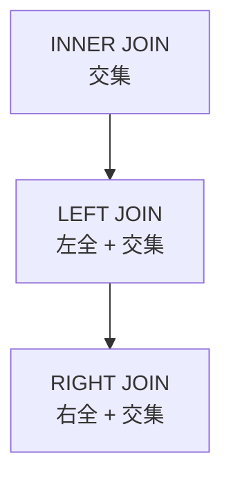

**授课目标**：彻底解决上节课遗留的"笛卡尔积"数据爆炸问题。掌握基于条件关联的普通多表查询、利用 `IN` 关键字的嵌套子查询，深刻理解企业级开发中最核心的 **JOIN**（内连接、左外连接、右外连接）数据融合技术，并学会使用**视图 (View)** 将复杂的查询虚拟化。

## 一、消除笛卡尔积：普通多表查询与条件关联

为了消除多表同查时产生的无效组合，我们必须在 `WHERE` 子句中**显式指定两张表的关联关系**（通常是"**主键 = 外键**"）。

### 1. 基础字段映射

**需求 1**：请查询出每一个学员的姓名、年龄、班级名称和班级创建时间？

```sql
-- 通过 user.class_id = class.id 将两张表正确绑定
SELECT user.username, user.age, class.name, class.ctime FROM user, class WHERE user.class_id=class.id;
```

### 2. 结合内置函数处理复杂输出

**需求 2**：请查询出每一个学员的信息，并把班级的创建时间戳 (ctime) 转成正常日期显示出来？

```sql
-- 结合上一节课学过的 FROM_UNIXTIME 函数
SELECT user.username, user.age, class.name, FROM_UNIXTIME(class.ctime) AS ctime FROM user, class WHERE user.class_id=class.id;
```

### 3. 复合条件过滤

**需求 3**：查询学员的姓名、年龄和班级，并且只查询"1班"的学员？

```sql
-- 在表关联的基础上，使用 AND 拼接额外的过滤条件
SELECT user.username, user.age, class.name, class.ctime FROM user, class WHERE user.class_id=class.id AND class.id=1;
```

**表别名让 SQL 更简洁**

```sql
SELECT u.username, u.age, c.name
FROM user u, class c
WHERE u.class_id = c.id AND c.id = 1;
```

## 二、嵌套查询（子查询）

嵌套查询是指**将一个 `SELECT` 语句的查询结果作为另一个 `SELECT` 语句的条件**（通常配合 `IN` 关键字使用）。

### 1. 基于子表查主表

**需求 4**：查询 `user` 表中存在的所有班级的信息？

```sql
-- 先从 user 表查出所有存在的 class_id 并去重，再以此作为 class 表的查询范围
SELECT * FROM class WHERE id IN(SELECT DISTINCT class_id FROM user);
```

### 2. 基于主表查子表

**需求 5**：查询班级表中每个班的所有学员信息？

```sql
SELECT * FROM user WHERE class_id IN(SELECT id FROM class);
```

**子查询的三种类型**

| 类型 | 返回 | 示例 |
| :--- | :--- | :--- |
| **标量子查询** | **单个值** | `WHERE age > (SELECT AVG(age) FROM user)` |
| **列子查询** | **一列多值** | `WHERE id IN (SELECT class_id FROM user)` |
| **行子查询** | 一行多列 | `WHERE (a,b) = (SELECT x,y FROM t)` |

另外还有**相关子查询**（内层引用外层字段，逐行执行，性能较差）：
```sql
SELECT * FROM user u WHERE EXISTS (SELECT 1 FROM class c WHERE c.id=u.class_id);
```

> [!warning] `IN` 子查询性能提示
> `NOT IN` 遇到子查询结果含 NULL 时会**返回空结果**（经典坑）：
> ```sql
> -- ❌ 如果子查询结果里有 NULL，整个查询返回空
> SELECT * FROM t WHERE id NOT IN (SELECT class_id FROM user);
>
> -- ✅ 排除 NULL
> SELECT * FROM t WHERE id NOT IN (SELECT class_id FROM user WHERE class_id IS NOT NULL);
> ```
> 大表场景下，`IN` 子查询通常可以改写为 **JOIN**，性能更好。

## 三、表连接核心技术 (JOIN)

在正式讲解 JOIN 之前，我们先往班级表中**插入一条没有分配任何学员的新班级数据 (class4)**，这对于理解左/右连接至关重要。

```sql
-- 准备特殊测试数据：插入 class4
INSERT INTO class(id, name, ctime) VALUES (4, 'class4', 1492087405);
```

### 1. 左外连接 (LEFT JOIN)

> [!important] 核心逻辑（记住）
> **以 LEFT JOIN 左边的表为基准（主表），右边的表为从表。**
> **主表的数据会全部显示，从表匹配不到的数据则显示为 NULL。**

**需求 6**：请统计每个班的总人数（**包括没有人的 4 班**）？

**错误做法（普通分组）**：

```sql
SELECT class_id, COUNT(*) FROM user GROUP BY class_id;
```

- 这样**无法显示班级名称**，且**根本查不出 0 人的 4 班**。

**正确做法（左连接）**：

```sql
-- class 为左表(基准)，确保 class4 一定会出现，匹配不到 user 时 user.id 为 null，count(null) 结果为 0
SELECT class.name, COUNT(user.id) AS tot FROM class LEFT JOIN user ON class.id=user.class_id GROUP BY class.id;
```

> [!important] 为什么这里要用 `COUNT(user.id)` 而不是 `COUNT(*)`（关键，记住）
> `class4` 在 `user` 表里匹配不到任何行，JOIN 后会产生**一行 `user.id = NULL` 的记录**。
>
> - **`COUNT(*)`** 会把这一行也数进去 → **class4 会显示 1 人（错误）**
> - **`COUNT(user.id)`** 因为 `user.id` 是 NULL 会被跳过 → **class4 正确显示 0 人**
>
> **这就是"统计每组的数量，包括 0"必须用 `COUNT(从表字段)` 而不是 `COUNT(*)` 的原因。**

### 2. 右外连接 (RIGHT JOIN)

**核心逻辑**：以 RIGHT JOIN **右边的表**为基准。

在企业实战中，**左连接用得最多**，右连接可以完全**通过调换表位置转化为左连接**。

```sql
-- 将上一句的 LEFT 改为 RIGHT，并调换表位置，结果完全一致
SELECT class.name, COUNT(user.id) AS tot FROM user RIGHT JOIN class ON class.id=user.class_id GROUP BY class.id;
```

### 3. 内连接 (INNER JOIN)

**核心逻辑**：**只查出两张表中完全匹配的数据**。它的结果和第一讲的"普通多表查询"完全一样，但在目前的企业开发中，**更推荐使用语义更清晰的 `INNER JOIN ... ON ...` 语法**。

**需求 7**：查询每个用户的用户名和对应的班级名称？

```sql
SELECT user.username, class.name FROM user INNER JOIN class ON class.id=user.class_id;
```

### JOIN 类型对比

| 类型 | 结果集 | 匹配不到的行 |
| :--- | :--- | :--- |
| **INNER JOIN** | **只保留两表都匹配的行** | 丢弃 |
| **LEFT JOIN** | 左表**全保留** + 右表匹配的 | 右表列补 **NULL** |
| **RIGHT JOIN** | 右表**全保留** + 左表匹配的 | 左表列补 **NULL** |



**补充：MySQL 8.0 不再支持 `(+)` 写法**：Oracle 的 `WHERE a.id = b.id(+)` 写法在 MySQL 里**不认**，必须用 `LEFT JOIN`。

## 四、MySQL 视图 (View) 虚拟表

当一个多表连接查询非常复杂，且在业务逻辑中需要被频繁调用时，**每次手写冗长的 SQL 是不现实的**。视图可以把这个复杂的查询结果**包装成一张虚拟表**。

### 1. 视图的创建与查看

```sql
-- 创建一个名为 userclass 的视图，内容为连表查询的结果
CREATE VIEW userclass AS SELECT user.username, user.age, class.name FROM user, class WHERE user.class_id=class.id;

-- 查看数据库中的表和视图（视图会以表的形式存在）
SHOW TABLES;

-- 像查询普通表一样查询视图数据
SELECT * FROM userclass;
```

### 2. 视图的核心特性与删除

> [!important] 动态联动特性（记住）
> **视图本身不存储数据，它只是一个 SQL 逻辑。**
> **当底层的真实表数据发生变化时，视图查出的数据也会随着实时发生变化。**

```sql
-- 删除视图
DROP VIEW userclass;
```

### 视图的价值与限制

| 优点 | 说明 |
| :--- | :--- |
| **简化复杂查询** | 把多表 JOIN 封装成一个"表名" |
| **数据安全** | 只暴露部分字段，隐藏敏感列 |
| **逻辑解耦** | 底层表结构变化时，视图可保持不变 |

| 注意点 | 说明 |
| :--- | :--- |
| **性能** | 视图**不存储数据**，查询时**仍然执行底层 SQL**，不会变快 |
| **可更新性** | 含聚合、DISTINCT、GROUP BY、UNION 的视图**不可更新** |
| **嵌套** | 视图可以基于视图创建，但**层数多了执行计划会退化** |

**查已有视图定义**

```sql
SHOW CREATE VIEW userclass\G
SELECT * FROM information_schema.VIEWS WHERE TABLE_NAME='userclass'\G
```

---
