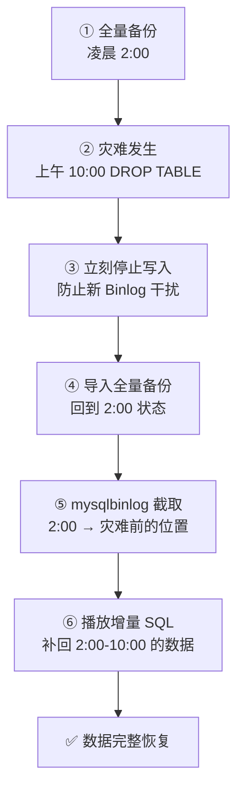

**授课目标**：直面企业 DBA 的**终极梦魇——数据误删**。透彻理解 MySQL 二进制日志（Binlog）的底层架构与**三大模式**。熟练运用 `mysqldump` 进行日常全量逻辑备份，并掌握结合 `mysqlbinlog` 工具实现"**基于时间点（Point-in-Time）**"的精准数据闪回抢救技术。

## 一、Binlog 核心机制与三大模式

MySQL 的二进制日志（Binary Log，简称 **Binlog**）**记录了数据库所有执行过的 DDL 和 DML 语句，但不包含 `SELECT` 等查询语句**。它是 MySQL **数据同步（主从复制）和灾难恢复的绝对基石**。

### 1. Binlog 的三大格式（Format）

| 模式 | 记录内容 | 优点 | 缺点 |
| :--- | :--- | :--- | :--- |
| **Statement** | **基于语句** —— 记录每一条修改数据的 **SQL 原文** | **体积小** | 在执行如 `UPDATE ... WHERE ... LIMIT 1` 或包含 `UUID()`、`NOW()` 函数时，会导致**主从节点数据不一致** |
| **Row** | **基于行** —— 不记录 SQL 语句上下文，**只记录哪条数据被修改成了什么样** | **数据一致性极高**，是实现**数据闪回的基础** | **体积较大** |
| **Mixed** | **混合模式** —— 系统自动判断，一般语句用 Statement，遇到可能引起不一致的特殊语句时切换为 Row | 折中 | **目前企业中已较少使用** |

> [!important] MySQL 8.0 默认是 Row（记住）
> **`Row` 是 MySQL 8.0 的默认且强烈推荐模式。**

> [!warning] Binlog 与 redo log / undo log 的区别（易混淆）
> | 日志 | 层级 | 作用 |
> | :--- | :--- | :--- |
> | **redo log** | **InnoDB 引擎层** | **崩溃恢复**（持久性）；环形写 |
> | **undo log** | **InnoDB 引擎层** | **事务回滚 + MVCC 快照** |
> | **Binlog** | **MySQL Server 层** | **主从复制 + 数据恢复**；追加写 |
>
> **三者的顺序**：写 undo → 改内存页 → 写 redo（prepare）→ 写 binlog → redo（commit）—— 这就是**两阶段提交**。

### 2. 在 CentOS 8 中配置并开启 Binlog

由于通过 dnf 安装的 MySQL 8.0 默认可能开启了 Binlog，但为了确保参数受控，我们需要**手动规范化配置**。

```bash
vi /etc/my.cnf.d/mysql-server.cnf
```

在 `[mysqld]` 模块下方添加以下核心配置：

```ini
# 开启 Binlog 并指定日志文件名前缀
log-bin=mysql-bin
# 强制使用基于行的记录模式
binlog-format=ROW
# 在集群或开启 Binlog 的环境下，必须配置全局唯一的 server-id
server-id=1
# 配置 Binlog 日志自动清理天数（MySQL 8.0 推荐使用 binlog_expire_logs_seconds）
binlog_expire_logs_seconds=604800
```

配置完成后，重启服务使其生效：

```bash
systemctl restart mysqld
```

登录 MySQL，验证 Binlog 是否成功运行：

```sql
-- 查看当前开启的所有 Binlog 文件列表
SHOW BINARY LOGS;
```

**`binlog_expire_logs_seconds=604800` 是多少天**：`604800` 秒 = **7 天**。

⚠️ **默认值是 30 天（2592000 秒）**。设太小会导致**闪回时日志已被清理**，设太大**磁盘会爆**。

**建议按"全量备份周期 × 2 + 余量"来设** —— 比如每天备份，留 7 天就够。

## 二、逻辑备份利器：mysqldump 实战

在日常运维中，我们通常会在**每天凌晨业务低谷期执行一次"全量备份"**。`mysqldump` 是 MySQL 官方自带的**逻辑备份工具**，它会将**表结构和数据逆向解析为 `.sql` 文本文件**。

> [!danger] 备份时务必加上 `--single-transaction` 参数（记住）
> 它能在**不锁表**的情况下利用 InnoDB 的 **MVCC 机制**完成一致性备份，**避免在备份期间导致业务系统假死**。

### 1. 备份全库或特定数据库

```bash
# 提前创建一个备份存放目录
mkdir -p /backup/mysql/

# 将 mydb 数据库全量导出到指定的 sql 文件中
mysqldump -uroot -p'wei@12345' --single-transaction --databases mydb > /backup/mysql/mydb_full_$(date +%F).sql
```

### 2. 精确备份单张核心表

如果只想备份特定的关键表（如 `user` 和 `account`）：

```bash
mysqldump -uroot -p'wei@12345' --single-transaction mydb user account > /backup/mysql/mydb_tables.sql
```

> [!warning] 参数顺序很重要
> `mysqldump [选项] 数据库名 [表名...]` —— **数据库名在选项之后，表名在数据库名之后**。
>
> 写错顺序会报错或备份错对象。

### mysqldump 常用参数速查

| 参数 | 作用 |
| :--- | :--- |
| **`--single-transaction`** | **一致性备份，不锁表**（InnoDB 必备） |
| **`--databases`** | 导出时**包含 `CREATE DATABASE` 语句** |
| `--all-databases` | 备份**所有库** |
| `--routines` | **包含存储过程和函数** |
| `--triggers` | **包含触发器**（默认开） |
| `--events` | 包含事件调度器 |
| `--no-data` | **只导结构，不导数据** |
| `--no-create-info` | **只导数据，不导结构** |
| `--master-data=2` | **记录 Binlog 位置**（用于 PITR，**很关键**） |
| `--flush-logs` | 备份前切割 Binlog |
| `--where="条件"` | 只导部分数据 |
| `--ignore-table=db.tbl` | 排除某张表 |

**生产级备份脚本范例（记住这个模板）**

```bash
#!/bin/bash
BACKUP_DIR=/backup/mysql
DATE=$(date +%F_%H%M)
DB=mydb
mysql -uroot -p'wei@12345' -e "FLUSH LOGS;"          # 先切 Binlog
mysqldump -uroot -p'wei@12345' \
  --single-transaction --master-data=2 --routines \
  --databases $DB | gzip > $BACKUP_DIR/${DB}_${DATE}.sql.gz
find $BACKUP_DIR -name "*.sql.gz" -mtime +7 -delete    # 删 7 天前
```

## 三、删库不跑路：基于时间点的闪回恢复实战

> [!important] 真实灾难场景（记住这个思路）
> **凌晨 2:00** 系统自动完成了全量备份；
> **上午 10:00**，一名开发人员在执行 `UPDATE` 或 `DELETE` 时**忘记加 `WHERE` 条件**，瞬间全表数据被污染或清空。
>
> **此时，不能只用凌晨的备份文件恢复**，否则 **2:00 到 10:00 之间产生的新业务数据将全部丢失**！
>
> **我们需要的是：全量备份 + Binlog 的组合拳。**

### 实战模拟与抢救流程

#### Step 1: 制造灾难与现场封锁

```sql
-- 10:00 发生灾难：开发人员误删了 mydb 库中的 user 表
DROP TABLE mydb.user;
```

> [!danger] 灾难发生后立刻做的事
> **立刻切断应用层对数据库的写入请求（或锁定数据库），防止产生新的 Binlog 干扰。**

#### Step 2: 恢复凌晨的全量备份

首先，将数据库**倒退回凌晨 2:00 的安全状态**。

```bash
# 将凌晨备份的 sql 脚本重新导入 MySQL
mysql -uroot -p'wei@12345' < /backup/mysql/mydb_full_2026-10-09.sql
```

此时 `user` 表回来了，但**数据只停留在 2:00**。

#### Step 3: 利用 mysqlbinlog 精准提取增量数据

```bash
# 查看在全量备份后执行的insert操作，重点查看at位置和时间，如：
# at 137745
# 261010  8:55:00
mysqlbinlog --base64-output=decode-rows -vv /var/lib/mysql/mysql-bin.000001 | grep -n -B 20 -A 20 -i -E "user5000|user5003"
```

**完整的 insert user5000 的 bin-log 信息如下**：

```text
30985-# at 137745 (上一个事件的结束pos,同时是下一个事件的开始pos)
30986-#261010  8:55:00 server id 1  end_log_pos 137824 CRC32 0x0c0e0039         Anonymous_GTID        last_committed=48     sequence_number=49        rbr_only=yes        original_committed_timestamp=1791636900638962        immediate_commit_timestamp=1791636900638962        transaction_length=299
30987-/*!50718 SET TRANSACTION ISOLATION LEVEL READ COMMITTED*//*!*/;
30988-# original_commit_timestamp=1791636900638962 (2026-10-10 08:55:00.638962 EDT)
30989-# immediate_commit_timestamp=1791636900638962 (2026-10-10 08:55:00.638962 EDT)
30990-/*!80001 SET @@session.original_commit_timestamp=1791636900638962*//*!*/;
30991-/*!80014 SET @@session.original_server_version=80021*//*!*/;
30992-/*!80014 SET @@session.immediate_server_version=80021*//*!*/;
30993-SET @@SESSION.GTID_NEXT= 'ANONYMOUS'/*!*/;
30994-# at 137824
30995-#261010  8:55:00 server id 1  end_log_pos 137899 CRC32 0x9ca498e3         Query        thread_id=15        exec_time=0   error_code=0
30996-SET TIMESTAMP=1791636900/*!*/;
30997-SET @@session.foreign_key_checks=1, @@session.unique_checks=1/*!*/;
30998-SET @@session.sql_mode=1168113696/*!*/;
30999-BEGIN
31000-/*!*/;
31001-# at 137899
31002-#261010  8:55:00 server id 1  end_log_pos 137959 CRC32 0xa193c913         Table_map: `mydb`.`user` mapped to number 122
31003-# at 137959
31004-#261010  8:55:00 server id 1  end_log_pos 138013 CRC32 0x41ec8bc6         Write_rows: table id 122 flags: STMT_END_F
31005-### INSERT INTO `mydb`.`user`
31006-### SET
31007-###   @1=5011 /* INT meta=0 nullable=0 is_null=0 */
31008:###   @2='user5000' /* VARSTRING(200) meta=200 nullable=0 is_null=0 */
31009-###   @3=18 /* TINYINT meta=0 nullable=0 is_null=0 */
31010-###   @4=1 /* INT meta=0 nullable=0 is_null=0 */
31011-# at 138013
31012-#261010  8:55:00 server id 1  end_log_pos 138044 CRC32 0x689b02c3         Xid = 562
31013-COMMIT/*!*/;
31014-# at 138044 (上一个事件的结束pos,同时是下一个事件的开始pos)
```

**获取删除 drop table user 的 bin-log 方法**：

```bash
mysqlbinlog --base64-output=decode-rows -vv /var/lib/mysql/mysql-bin.000001 | grep -n -B 20 -A 20 -i "DROP TABLE \`user\`"
```

**完整的删除 drop table user 的 bin-log 信息如下**：

```text
31068-# at 138642 (上一个事件的结束pos,同时是下一个事件的开始pos)
31069-#261010  8:55:38 server id 1  end_log_pos 138719 CRC32 0x0663f523         Anonymous_GTID        last_committed=51     sequence_number=52        rbr_only=no        original_committed_timestamp=1791636938604858        immediate_commit_timestamp=1791636938604858        transaction_length=206
31070-# original_commit_timestamp=1791636938604858 (2026-10-10 08:55:38.604858 EDT)
31071-# immediate_commit_timestamp=1791636938604858 (2026-10-10 08:55:38.604858 EDT)
31072-/*!80001 SET @@session.original_commit_timestamp=1791636938604858*//*!*/;
31073-/*!80014 SET @@session.original_server_version=80021*//*!*/;
31074-/*!80014 SET @@session.immediate_server_version=80021*//*!*/;
31075-SET @@SESSION.GTID_NEXT= 'ANONYMOUS'/*!*/;
31076-# at 138719
31077-#261010  8:55:38 server id 1  end_log_pos 138848 CRC32 0x237b858d         Query        thread_id=15        exec_time=0   error_code=0        Xid = 566
31078-SET TIMESTAMP=1791636938/*!*/;
31079-SET @@session.pseudo_thread_id=15/*!*/;
31080:DROP TABLE `user` /* generated by server */
31081-/*!*/;
31082-# at 138848 (上一个事件的结束pos,同时是下一个事件的开始pos)
```

> [!important] 注意（记住）
> **`DROP` 本身是隐匿事务提交，后面并没有体现出 `COMMIT`，但增、删、改会有显式的提交动作 `COMMIT`。**

#### Step 3（续）: 利用 mysqlbinlog 精准提取增量数据

找到从 **2:00 备份结束**，到 **10:00 灾难发生前**这一段时间的 Binlog 记录，并**重新播放一次**。在 CentOS 8 默认环境下，Binlog 存放于 **`/var/lib/mysql/`**。

```bash
# 使用 mysqlbinlog 工具，根据位置点截取日志
# --start-position: 增量数据的起点
# --stop-position: 灾难发生的瞬间前一秒 (避开那条该死的 DROP 语句)
mysqlbinlog --start-position=137745 --stop-position=138642 /var/lib/mysql/mysql-bin.000001 > /backup/mysql/increment.sql
```

**进阶拓展**：如果时间点不够精确，可以使用 `--start-position` 和 `--stop-position` 基于**事务的 Pos 号**进行**像素级精准截取**。

```bash
# 也可以用时间点
mysqlbinlog --start-datetime='2026-10-10 02:00:00' \
            --stop-datetime='2026-10-10 09:59:59' \
            /var/lib/mysql/mysql-bin.000001 > increment.sql
```
⚠️ **时间点方式用的是 Binlog 里的服务器时间，且同一秒内的事件无法精确区分 —— 优先用 position。**

#### Step 4: 播放增量日志，完成数据拼图

```bash
# 将截取出来的增量 SQL 脚本导入数据库
mysql -uroot -p'wei@12345' < /backup/mysql/increment.sql
```

**增量恢复前**：

```text
mysql> select * from user order by id desc limit 3;
+------+----------------+-----+----------+
| id   | username       | age | class_id |
+------+----------------+-----+----------+
| 5010 | test_user_4999 |  21 |        2 |
| 5009 | test_user_4998 |  34 |        3 |
| 5008 | test_user_4997 |  26 |        2 |
+------+----------------+-----+----------+
3 rows in set (0.00 sec)
```

**增量恢复后**：

```text
mysql> select * from user order by id desc limit 3;
+------+----------+-----+----------+
| id   | username | age | class_id |
+------+----------+-----+----------+
| 5013 | user5003 |  38 |        3 |
| 5012 | user5001 |  28 |        2 |
| 5011 | user5000 |  18 |        1 |
+------+----------+-----+----------+
3 rows in set (0.00 sec)
```

登录数据库查验，**被误删的表不仅恢复了，连同早间 8 点产生的新业务数据也毫发无损地找了回来**。至此，数据危机完美解除。

### PITR 恢复流程总结



> [!important] 这套流程的三个关键点（记住）
> 1. **备份必须带 `--master-data=2`** —— 才知道备份对应的 Binlog 起点在哪
> 2. **Binlog 必须开启且保留足够久** —— 否则增量部分无从恢复
> 3. **`--stop-position` 要精确到"灾难语句的前一个位置"** —— 差一点就会把 `DROP` 也重放一遍

---
