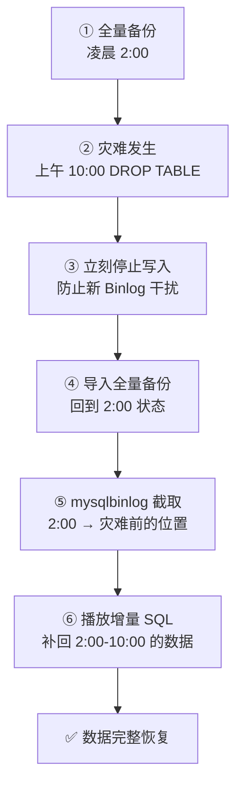

# MySQL 8.0 课程笔记（第 1-15 节）

> [!info] 实验环境
> **VMware + CentOS 8.4 + dnf 本地光盘源 + MySQL 8.0**

## 课程目录速览

| 节次 | 章节名称 | 核心内容 |
| :--- | :--- | :--- |
| **第 1 节** | CentOS 8.4 环境搭建与 MySQL 8.0 基础启停 | 本地 dnf 光盘源配置与免网安装、systemctl 服务管控、MySQL 8.0 安全初始化配置 |
| **第 2 节** | 数据库设计、存储引擎与表结构管理 (DDL) | InnoDB 底层原理（废弃 `.frm`）、库表生命周期管理、表复制技术 |
| **第 3 节** | 数据类型、字段属性与字符集规范 | 数值/字符串/日期核心类型、unsigned/auto_increment 约束、utf8mb4 字符集解析、ALTER TABLE 高级管理 |
| **第 4 节** | 数据操作语言 (DML) 与基础查询 (DQL) | 标准的增删改查语法、DELETE 与 TRUNCATE 的底层差异剖析 |
| **第 5 节** | 数据过滤、排序与高级搜索技术 | WHERE 核心条件、模糊匹配与正则表达式 (REGEXP)、结果集去重与 LIMIT 分页技术 |
| **第 6 节** | MySQL 8.0 内置函数与实战应用 | 高频字符串清洗、数学极值计算、时间戳与日期转换函数 |
| **第 7 节** | 数据统计、分组聚合 (Group By) 与多表理论 | 五大聚合函数、GROUP BY 分组统计实战、多表关联理论与"笛卡尔积"性能灾难演示 |
| **第 8 节** | 多表嵌套子查询与表连接 (Join) 核心技术 | IN 嵌套查询、内连接 (INNER JOIN)、左/右外连接实战、视图 (VIEW) 虚拟化技术 |
| **第 9 节** | 索引管理 (Index) 与 SQL 执行效率分析 | 索引的分类与创建、复合索引最左前缀原则、使用 EXPLAIN 排查四大高频索引失效场景 |
| **第 10 节** | MySQL 服务器监控、慢查询优化与安全急救 | 全局状态监控 (SHOW STATUS)、慢查询日志配置、跳过授权表极限营救 MySQL 8.0 root 密码 |
| **第 11 节** | 核心事务机制 (Transaction) 与并发控制 | ACID 四大特性、事务开启/提交/回滚实战、四大隔离级别与 MySQL 8.0 默认隔离级别 (RR) |
| **第 12 节** | 触发器 (Trigger) 与存储过程 (Stored Procedure) | 触发器语法与 NEW/OLD 关键字、订单插入自动扣减库存实战；存储过程 IF/WHILE 控制结构、批量造数脚本封装 |
| **第 13 节** | MySQL 8.0 用户角色 (Role) 与细粒度权限管控 | 用户创建、密码过期策略、远程登录授权；角色创建、权限打包分配与激活机制；GRANT/REVOKE 表级细粒度权限 |
| **第 14 节** | Binlog 日志机制与数据备份恢复体系 | Binlog 开启与三大模式、mysqldump 全量备份与单表导出、基于时间点 (Point-in-Time) 的误删数据闪回 |
| **第 15 节** | 表分区技术 (Partitioning) 与海量数据架构展望 | RANGE 范围分区实战、HASH/LIST 分区简介、分区表维护 (ADD/DROP PARTITION) |

---

# 第 1 节：CentOS 8.4 环境搭建与 MySQL 8.0 基础启停

> [!important] 授课目标
> 掌握在纯 Linux (CentOS 8.4) 环境下，**脱离网络使用本地光盘源**快速部署 MySQL 8.0 数据库服务器的能力，并熟练掌握基于 `systemctl` 的服务管理，以及 MySQL 8.0 全新的安全初始化流程。

## 一、VMware 虚拟机挂载 CentOS 8.4 DVD 光盘

### 1. 物理挂载（VMware 界面操作）

> 右键点击虚拟机 → 【设置】(Settings) → 【CD/DVD (IDE)】 → 勾选【**启动时连接**】(Connect at power on) → 选择【使用 ISO 映像文件】(Use ISO image file) → 浏览并选中你的 CentOS 8.4 ISO 文件 → 点击【确定】

### 2. 系统内挂载（Linux 命令行操作）

开启虚拟机，登录 root 账号，执行挂载命令将光盘挂载到 `/media` 目录下。

```bash
# 将系统识别的光驱设备 /dev/cdrom 挂载到 /media 目录
mount /dev/cdrom /media/

# 检查是否挂载成功（查看光盘内的文件）
ls /media/
# 预期会看到 AppStream、BaseOS 等目录
```

> [!important] CentOS 8 光盘结构与 7 不同（记住）
> **核心系统包在 `BaseOS` 目录**，而**应用软件（如 MySQL）在 `AppStream` 目录**。
>
> 所以配置本地源时**必须配两个仓库**（BaseOS + AppStream）。

## 二、配置本地 dnf 光盘源（彻底告别网络依赖）

CentOS 8 使用 **dnf** 作为新一代包管理器。为了保证安装速度和不受网络环境影响，我们配置本地光盘源。

### 1. 备份原有的网络源文件

```bash
# 进入 repo 配置文件目录
cd /etc/yum.repos.d/

# 创建备份文件夹并将所有默认源移入备份
mkdir backup
mv *.repo backup/
```

### 2. 创建本地 dnf 配置文件

```bash
vi /etc/yum.repos.d/local.repo
```

> 使用 vi 编辑器创建新的 repo 文件：按 `i` 键进入编辑模式，编辑完成后按 `ESC`，输入 `:wq` 保存并退出。

```ini
[BaseOS]
name=CentOS-8-BaseOS
baseurl=file:///media/BaseOS
gpgcheck=0
enabled=1

[AppStream]
name=CentOS-8-AppStream
baseurl=file:///media/AppStream
gpgcheck=0
enabled=1
```

### 3. 清理缓存并生成本地源缓存

```bash
dnf clean all
dnf makecache
```

**测试**：运行 `dnf list mysql-server`，如果能正常列出 MySQL 软件包信息，说明本地源配置成功！

```bash
dnf list mysql-server
```

> [!tip] `gpgcheck=0` 的原因
> 本地光盘源如果开了 `gpgcheck=1`，需要**额外指定 gpgkey 路径**。为了简化实验，这里关掉校验。
>
> 生产环境**建议开启校验**：
> ```ini
> gpgcheck=1
> gpgkey=file:///etc/pki/rpm-gpg/RPM-GPG-KEY-centosofficial
> ```

## 三、使用 dnf 安装 MySQL 8.0

> CentOS 8 的 AppStream 仓库中**已经默认包含了 MySQL 8.0 模块**，这让我们无需再去官网下载繁琐的 rpm 压缩包。

```bash
# -y 参数表示安装过程中自动回答 yes
dnf install mysql-server -y
```

等待进度条跑完，提示 `Complete!` 即代表安装成功。

> [!tip] 也可以用模块流指定版本
> ```bash
> dnf module list mysql              # 查看可用的 mysql 模块流
> dnf module enable mysql:8.0        # 启用 8.0 流
> dnf install mysql-server -y
> ```

## 四、systemctl 服务管理

> 在 CentOS 8 中，我们使用系统自带的 `systemctl` 来接管 MySQL 服务的启停（**注意服务名为 `mysqld`，不是 `mysql`**）

```bash
# 1. 启动 MySQL 服务
systemctl start mysqld

# 2. 停止 MySQL 服务
systemctl stop mysqld

# 3. 重启 MySQL 服务
systemctl restart mysqld

# 4. 查看 MySQL 运行状态（绿色 active (running) 表示正常运行）
systemctl status mysqld

# 5. 设置 MySQL 开机自启动（企业服务器必备操作）
systemctl enable mysqld
```

> [!warning] 默认只能本机访问
> MySQL 8 默认启动后是 **socket 方式**，但**只能本机使用 MySQL 服务器，不能远程访问**。如果要远程访问，需要开启 MySQL 服务器的 3306 端口：

```bash
vi /etc/my.cnf.d/mysql-server.cnf
```

```ini
[mysqld]
port=3306
bind-address=0.0.0.0
```

```bash
systemctl restart mysqld
```

> [!warning] `bind-address=0.0.0.0` 的安全风险
> 监听所有网卡后，**任何能连通 3306 的主机都可以尝试连接**。
>
> 生产环境必须配合：
> 1. **防火墙限制来源 IP**：`firewall-cmd --add-rich-rule='rule family=ipv4 source address=192.168.10.0/24 port port=3306 protocol=tcp accept'`
> 2. **数据库层限制来源**：创建用户时限定 `@'192.168.10.%'`，**绝不用 `@'%'`**
> 3. 开启 SSL 或走内网专线

## 五、MySQL 8.0 初始密码获取与安全初始化

### 1. 无密码直接登录（CentOS 8 AppStream 版本的特性）

> 与官方 RPM 包生成随机密码不同，**通过 CentOS 8 dnf 安装的 MySQL 8.0 首次启动时，默认 root 用户没有密码**。

```bash
# 直接登录 MySQL
mysql -u root
```

> [!important] 与官方 RPM 包的区别（记住）
> | 安装方式 | 初始密码 |
> | :--- | :--- |
> | **CentOS 8 dnf 安装** | **root 无密码**，可直接 `mysql -u root` |
> | **MySQL 官方 RPM 包** | 生成**随机密码**，存在 `/var/log/mysqld.log` 中 |
>
> 官方包查密码：`grep 'temporary password' /var/log/mysqld.log`

### 2. 手动修改初始密码

进入 `mysql>` 提示符后，**必须第一时间设置符合 MySQL 8.0 密码强度要求的强密码**（包含大小写字母、数字和特殊符号）。

```sql
-- 修改 root 密码为 'wei@12345'
ALTER USER 'root'@'localhost' IDENTIFIED BY 'wei@12345';

-- 刷新权限并退出
FLUSH PRIVILEGES;
exit;
```

### 3. 使用自带的安全向导加固数据库（推荐做法）

退出 MySQL 后，在 Linux 命令行执行安全配置向导，一步步提升数据库安全性。

```bash
mysql_secure_installation
```

#### 安全向导交互流程解析

| 提示 | 建议输入 | 说明 |
| :--- | :--- | :--- |
| `Enter password for user root:` | `wei@12345` | 输入刚才设置的密码 |
| `VALIDATE PASSWORD COMPONENT...`（是否安装密码校验插件?） | **`y`** | 启用密码强度校验 |
| `Please enter 0 = LOW, 1 = MEDIUM and 2 = STRONG:`（密码强度级别） | **`1`** | 中级 |
| `Remove anonymous users?`（是否移除匿名用户?） | **`y`** | 移除匿名用户，安全必备 |
| `Disallow root login remotely?`（是否禁止 root 远程登录?） | **教学环境 `n`，生产环境必选 `y`** | 教学环境方便连接 |
| `Remove test database and access to it?`（是否删除 test 数据库?） | **`y`** | 删除测试库 |
| `Reload privilege tables now?`（是否重新加载权限表?） | **`y`** | 立即生效 |

> [!important] 密码强度等级（记住）
> | 级别 | 要求 |
> | :--- | :--- |
> | **0 = LOW** | 长度 ≥ 8 |
> | **1 = MEDIUM** | 长度 ≥ 8 + **数字 + 大小写字母 + 特殊字符** |
> | **2 = STRONG** | MEDIUM + **必须对照字典文件检查，不能是常见词** |
>
> 生产环境建议用 **2 (STRONG)**。

> [!tip] 第1节小结
> 至此，MySQL 8.0 已经以极其标准、安全的姿态运行在 CentOS 8.4 服务器上了。

---

# 第 2 节：数据库设计、存储引擎与表结构管理 (DDL)

> [!important] 授课目标
> 深入理解 MySQL 8.0 默认存储引擎 InnoDB 的底层文件结构，掌握数据库与数据表的基础 DDL 操作，并熟练使用表复制技术进行快速数据备份与迁移。

## 一、数据表引擎深度剖析：MySQL 8.0 存储结构的巨大变革

> [!important] MySQL 8.0 最大的变化（面试必考，记住）
> 在之前的 MySQL 5.7 版本中，不论是 InnoDB 还是 MyISAM 引擎，**表结构元数据都统一存储在 `.frm` 文件中**。
>
> 但在 **MySQL 8.0 中，由于引入了全新的事务性数据字典，`.frm` 文件被彻底废弃！**

### 1. InnoDB 引擎（MySQL 8.0 默认且最核心的引擎）

在 CentOS 8 系统中，MySQL 的默认数据目录位于 **`/var/lib/mysql/`**。

当创建一张 InnoDB 表时，底层文件结构如下：

| 文件 | 说明 |
| :--- | :--- |
| **表名.ibd** | **表空间文件**，包含该表的**表索引 + 表数据**。在 MySQL 8.0 中，它还**内置了表的序列化字典信息（SDI，替代了旧版的 `.frm`）** |
| **ibdata1** | **系统表空间文件**，所有数据库中的 InnoDB 表**共享此文件**，用于存储 **undo 日志、更改缓冲区**等底层数据 |

### 2. MyISAM 引擎（不支持事务，主要用于极高并发的只读业务）

| 文件 | 说明 |
| :--- | :--- |
| **表名.MYD** | (MY**D**ata) 专门用来存储**表数据** |
| **表名.MYI** | (MY**I**ndex) 专门用来存储**表索引** |
| **表名_xxx.sdi** | MySQL 8.0 新增，以 **JSON 格式**存储该表的**表结构元数据**（替代了旧版的 `.frm`） |

> [!info] SDI 是什么
> **SDI = Serialized Dictionary Information（序列化字典信息）**
>
> MySQL 8.0 把表结构元数据**写进了表空间文件本身**（InnoDB 存在 `.ibd` 里，MyISAM 存在 `.sdi` 里）。
>
> 好处：**表结构可随表空间文件一起迁移/备份**，不再依赖外部字典文件。
>
> 查看 SDI：
> ```bash
> ibd2sdi /var/lib/mysql/mydb/user.ibd
> ```

### 引擎对比

| 维度 | **InnoDB** | MyISAM |
| :--- | :--- | :--- |
| **事务** | ✅ 支持 | ❌ 不支持 |
| **行锁** | ✅ 支持 | ❌ 只有表锁 |
| **外键** | ✅ 支持 | ❌ 不支持 |
| **崩溃恢复** | ✅ 强 | ❌ 弱 |
| **全文索引** | ✅ 5.6+ 支持 | ✅ 支持 |
| 存储文件 | `.ibd`（+ `ibdata1`） | `.MYD` + `.MYI` + `.sdi` |
| 适用 | **读写混合、要求可靠** | **极高并发的只读业务** |

> [!tip] 怎么查表的引擎
> ```sql
> SHOW TABLE STATUS LIKE 'user'\G
> SHOW CREATE TABLE user\G
> ```

## 二、数据库管理 (Database 管理)

我们在终端登录 MySQL (`mysql -uroot -p`) 后，开始执行数据库级的操作。

### 1. 查看数据库

```sql
SHOW DATABASES;
```

### 2. 创建数据库（极力推荐指定字符集）

虽然可以直接 `CREATE DATABASE test;`，但在真实企业开发中，**为了防止中文乱码，推荐显式指定 MySQL 8.0 的默认字符集 `utf8mb4`**。

```sql
-- 创建一个名为 mydb 的数据库，并指定字符集为 utf8mb4
CREATE DATABASE mydb DEFAULT CHARACTER SET utf8mb4 COLLATE utf8mb4_0900_ai_ci;
```

### 3. 进入/切换数据库

要对表进行操作，**必须先指定当前操作的数据库**。

```sql
USE mydb;
-- Database changed
```

### 4. 删除数据库

> ⚠️ **危险操作，会清除该数据库下的所有表和数据。**

```sql
DROP DATABASE test;
```

## 三、数据表管理 (Table 管理)

进入 `mydb` 数据库后，我们开始管理数据表。

### 1. 创建表

创建一个标准的员工表（`user` 表），包含编号、用户名和密码。

```sql
CREATE TABLE user(
    id int,
    username varchar(50),
    password varchar(50)
) ENGINE=InnoDB DEFAULT CHARSET=utf8mb4;
```

> 可以在建表语句最后使用 `ENGINE=` 显式指定引擎，不过 **MySQL 8.0 默认即为 InnoDB**。

### 2. 查看所有表与查看表结构

```sql
-- 查看当前数据库中的所有表
SHOW TABLES;

-- 查看 user 表的具体字段结构
DESC user;
```

### 3. 修改表名

在业务重构时经常用到修改表名功能。

```sql
-- 将 user 表重命名为 user2
RENAME TABLE user TO user2;

-- 演示完毕后，请将其改回 user，方便后续测试
RENAME TABLE user2 TO user;
```

### 4. 删除表

彻底摧毁一张表及其包含的所有数据。

```sql
-- 测试专用代码，执行后需重新运行上方的 CREATE TABLE 语句恢复表
DROP TABLE user;

-- 更稳妥的写法（表不存在也不报错）
DROP TABLE IF EXISTS user;
```

## 四、表复制技术

> 在进行危险的数据更新或测试前，DBA 经常需要快速备份一张表。分为"**仅复制结构**"和"**复制结构+数据**"两步。

### 1. 准备测试数据

```sql
INSERT INTO user(id, username, password) VALUES (1, 'user1', '123');
INSERT INTO user(id, username, password) VALUES (2, 'user2', '456');
```

### 2. 复制表结构（克隆空表）

使用 **`LIKE`** 关键字，可以完美克隆原表的**字段结构、索引等属性**，但**不包含数据**。

```sql
-- 创建一张名为 student 的新表，结构与 user 表完全一致
CREATE TABLE student LIKE user;

-- 此时查询 student 表是空的
SELECT * FROM student;
```

### 3. 复制表内容（灌入数据）

使用 **`INSERT INTO ... SELECT`** 语句，将 `user` 表的数据查出并直接灌入 `student` 表。

```sql
-- 将 user 表的所有数据插入到 student 表中
INSERT INTO student SELECT * FROM user;

-- 验证数据是否复制成功
SELECT * FROM student;
```

```text
+------+----------+----------+
| id   | username | password |
+------+----------+----------+
|    1 | user1    | 123      |
|    2 | user2    | 456      |
+------+----------+----------+
2 rows in set (0.00 sec)
```

> [!tip] 一步完成"结构+数据"的复制
> 上面的两步可以用一条语句搞定：
> ```sql
> CREATE TABLE student AS SELECT * FROM user;
> ```
> ⚠️ **但这种方式会丢失索引、主键、自增等属性**，只复制字段和数据。
> 所以**要完整备份还是用 `LIKE` + `INSERT ... SELECT` 两步走**。

> [!info] 三种复制方式的区别
> | 语句 | 结构 | 索引/主键 | 数据 |
> | :--- | :---: | :---: | :---: |
> | `CREATE TABLE b LIKE a;` | ✅ | ✅ | ❌ |
> | `CREATE TABLE b AS SELECT * FROM a;` | ✅ | ❌ | ✅ |
> | `LIKE` + `INSERT ... SELECT` | ✅ | ✅ | ✅ |

---

# 第 3 节：数据类型、字段属性与字符集规范

> [!important] 授课目标
> 掌握 MySQL 核心数据类型的选择原理，深刻理解字段约束属性（尤其是 `unsigned` 与 `auto_increment`），了解 MySQL 8.0 字符集的底层优化，并熟练运用 `ALTER TABLE` 语句对表结构进行灵活的动态调整。

## 一、常用数据类型详解

> 在设计数据库时，选择合适的数据类型，既能保证最大长度或最大数值满足业务需求，又能**最大限度地节省占用空间**。

### 1. 数值型

| 类型 | 有符号范围 | 无符号 (unsigned) 范围 | 典型用途 |
| :--- | :--- | :--- | :--- |
| **tinyint** | -128 ~ +127 | **0 ~ 255** | 状态、年龄等小数值 |
| **int** | -2147483648 ~ 2147483647（约 ±21 亿） | **0 ~ 4294967295**（约 42 亿） | **最常用的主键类型** |
| **bigint** | -9223372036854775808 ~ 9223372036854775807 | 0 ~ 18446744073709551615 | **分布式 ID、超高频流水号** |

### 2. 字符串型

| 类型 | 特点 | 适用 |
| :--- | :--- | :--- |
| **char(M)** | **定长**字符串，最大长度 **255**。因为长度固定，**查询速度极快** | 手机号、**MD5 加密后的密码**等固定长度数据 |
| **varchar(M)** | **变长**字符串，最大长度理论值 **65535**。根据实际内容占用空间，**更为节省硬盘** | **目前使用最广的字符串类型** |
| **text 系列** | 用于存储大段文本文章 | 见下表 |

| text 类型 | 容量 |
| :--- | :--- |
| `tinytext` | 0 ~ 255 字节 |
| `text` | 0 ~ 65535 字节 |
| `mediumtext` | 0 ~ 16777215 字节（约 16MB） |
| `longtext` | 0 ~ 4294967295 字节（约 4GB） |

> [!tip] char vs varchar 怎么选（记住）
> | 场景 | 选择 |
> | :--- | :--- |
> | 长度**固定**（手机号、身份证、MD5、UUID） | **`char`**（定长，无额外长度开销，更快） |
> | 长度**变化大**（用户名、地址、备注） | **`varchar`**（变长，省空间） |
>
> ⚠️ `varchar` 需要 **1-2 字节额外空间**记录实际长度，且更新变长字段可能产生页分裂。

### 3. 日期时间型

> 在企业开发中，关于时间的存储有**两种流派**：

| 流派 | 说明 |
| :--- | :--- |
| **int 时间戳** | 将时间转化为**秒数**（如 `1492086867`），以 `int` 类型存储。这种方式**跨时区极其方便，查询效率极高** |
| **datetime** | MySQL 原生日期时间类型（如 `'2026-10-09 22:00:00'`），**直观易读**，MySQL 8.0 对其底层也进行了大量优化 |

> [!info] 补充：其他日期类型
> | 类型 | 范围 | 大小 | 特点 |
> | :--- | :--- | :--- | :--- |
> | `date` | 1000-01-01 ~ 9999-12-31 | 3 字节 | 只有日期 |
> | `time` | -838:59:59 ~ 838:59:59 | 3 字节 | 只有时间 |
> | `datetime` | 1000-01-01 00:00:00 ~ 9999-12-31 23:59:59 | **8 字节** | **不受时区影响** |
> | `timestamp` | 1970-01-01 ~ **2038-01-19** | **4 字节** | **随时区变化**，有 2038 问题 |
> | `int` | 1970 ~ 2038（无符号到 2106） | 4 字节 | 最省空间，**推荐** |

## 二、数据字段属性设置（约束）

> 字段属性是对字段类型的**进一步约束**，保证数据的合法性。

| 属性 | 说明 | 示例 |
| :--- | :--- | :--- |
| **`unsigned`** | **无符号**。只能存储正数，可以将正数的**取值范围扩大一倍** | `create table t2(id int unsigned);` |
| **`zerofill`** | **0 填充**。如果数值长度不够，左侧自动补 0，主要用于显示格式化 | `int(5) zerofill` → `00001` |
| **`auto_increment`** | **自动增长**。通常配合**主键** (`primary key`) 使用，实现 ID 的自动递增分配 | `create table t9(id int unsigned auto_increment primary key, username varchar(50));` |
| **`null` / `not null`** | `null` 表示该字段允许为空；`not null` 表示强制要求该字段必须有值，**不允许为空** | `username varchar(50) not null` |
| **`default`** | **默认值**。如果在插入数据时不指定该字段的值，则使用默认值 | `age int not null default 18;` |

> [!warning] `auto_increment` 的三个限制
> 1. **必须建在索引上**（通常是主键）
> 2. **一张表只能有一个** `auto_increment` 列
> 3. **类型必须是整数**（`tinyint`/`int`/`bigint`）

> [!info] `zerofill` 会自动附带 `unsigned`
> ```sql
> CREATE TABLE t (a INT(5) ZEROFILL);
> SHOW CREATE TABLE t\G
> -- 结果为：`a` int(5) unsigned zerofill
> ```
> 因为补零填充只对非负数有意义。

## 三、MySQL 8.0 全新默认字符集优势

> 过去 MySQL 中的 **`utf8` 其实是残缺的（最多支持 3 个字节）**，无法存储复杂的 **Emoji 表情和生僻字**。
>
> 在 **MySQL 8.0 中，官方做出了重大改变，将默认字符集全面升级为了真正的 UTF-8：`utf8mb4`**，并将默认的校验规则改为了更先进的 **`utf8mb4_0900_ai_ci`**。
>
> 这一改动意味着，你在 CentOS 8 下通过 dnf 安装的 MySQL 8.0，**无需再像旧版那样去繁琐修改 `my.cnf`，开箱即可完美支持所有生僻字与表情符号！**

### 字符集对比

| 字符集 | 最大字节 | 支持 Emoji | 说明 |
| :--- | :---: | :---: | :--- |
| `utf8`（MySQL 里的别名） | **3 字节** | ❌ | **是残缺的 UTF-8**，MySQL 8.0 中也叫 `utf8mb3` |
| **`utf8mb4`** | **4 字节** | ✅ | **真正的 UTF-8**，MySQL 8.0 默认 |

### 排序规则（Collation）解析

**`utf8mb4_0900_ai_ci`** 拆开看：

| 片段 | 含义 |
| :--- | :--- |
| `utf8mb4` | 字符集 |
| **`0900`** | 基于 **Unicode 9.0** 标准（MySQL 8.0 新增） |
| **`ai`** | **accent insensitive** —— **不区分重音**（`é` 和 `e` 视为相同） |
| **`ci`** | **case insensitive** —— **不区分大小写**（`A` 和 `a` 视为相同） |

> [!tip] 常见排序规则速查
> | 排序规则 | 区分大小写 | 区分重音 |
> | :--- | :---: | :---: |
> | `utf8mb4_0900_ai_ci` | ❌ | ❌ |
> | `utf8mb4_0900_as_cs` | ✅ | ✅ |
> | `utf8mb4_general_ci` | ❌ | ❌ | 旧版（5.7）默认，**排序不严谨** |
> | `utf8mb4_bin` | ✅ | ✅ | 按**二进制**比较，最严格 |

## 四、字段管理高级操作 (ALTER TABLE)

> 在日常开发中，业务需求经常变更，我们需要使用 `ALTER TABLE` 动态修改表结构。

### 1. 添加字段 (ADD)

**默认添加在表的最末尾**：

```sql
-- 给 user 表添加一个 age 字段，类型为无符号微小整型，不能为空
ALTER TABLE user ADD age tinyint unsigned not null;
```

**通过 `after` 指定添加到某个字段之后**：

```sql
-- 添加一个 pass 字段，紧跟在 username 字段之后
ALTER TABLE user ADD pass varchar(30) not null AFTER username;
```

**通过 `first` 添加到表的最前面**：

```sql
-- 将新字段添加到第一列
ALTER TABLE user ADD pass2 varchar(30) not null FIRST;
```

### 2. 删除字段 (DROP)

```sql
-- 删除刚才创建的 pass2 字段
ALTER TABLE user DROP pass2;

-- 按照原笔记示例，删除 password 字段
ALTER TABLE user DROP password;
```

### 3. 修改字段 (MODIFY 与 CHANGE)

| 关键字 | 能力 |
| :--- | :--- |
| **`MODIFY`** | 只能修改字段的**类型和属性**，**不能改字段名** |
| **`CHANGE`** | 可以**同时修改字段名、类型和属性** |

**语法**：

```sql
-- MODIFY：ALTER TABLE 表名 MODIFY 字段名 类型 约束;
-- CHANGE：ALTER TABLE 表名 CHANGE 旧字段名 新字段名 类型 约束;
```

```sql
-- 将 username 的长度修改为 30，并加上非空约束
ALTER TABLE user MODIFY username varchar(30) not null;

-- 将 username 字段改名为 user，同时设置类型和约束
ALTER TABLE user CHANGE username user varchar(30) not null;
```

> [!warning] MODIFY 会覆盖原有属性
> `MODIFY` / `CHANGE` **不是"增量修改"，而是"重新定义"**。
>
> 如果原来字段有 `DEFAULT 18`，你 `MODIFY age tinyint` 时**不写 default**，那么**默认值就被清掉了**。
>
> **改字段前先用 `SHOW CREATE TABLE user\G` 看清原定义。**

> [!tip] 其他常用 ALTER 操作
> ```sql
> -- 改表名
> ALTER TABLE user RENAME TO user2;
>
> -- 改引擎
> ALTER TABLE user ENGINE=InnoDB;
>
> -- 改字符集
> ALTER TABLE user CONVERT TO CHARACTER SET utf8mb4;
>
> -- 加索引
> ALTER TABLE user ADD INDEX i_age(age);
>
> -- 加主键
> ALTER TABLE user ADD PRIMARY KEY(id);
> ```

---

# 第 4 节：数据操作语言 (DML) 与基础查询 (DQL)

> [!important] 授课目标
> 理清 SQL 语言的四大阵营，熟练掌握表数据的"增删改" (DML) 核心操作，深刻理解 `DELETE` 与 `TRUNCATE` 在**自增体系下的本质区别**，并开启数据查询语言 (DQL) 的大门，掌握特定字段的提取与别名技术。

## 一、SQL 语言四大分类回顾

> 在正式操作数据之前，必须在理论层面认清 SQL 语句的四大基本分类，这是数据库工程师沟通的"黑话"：

| 分类 | 全称 | 用途 | 核心命令 |
| :--- | :--- | :--- | :--- |
| **DCL** | Data **Control** Language | 管理数据库的**用户权限与事务控制** | `grant`（授权）、`commit`（提交事务）、`rollback`（回滚事务） |
| **DDL** | Data **Definition** Language | 定义或修改**数据库结构** | `create`、`drop`、`alter` |
| **DML** | Data **Manipulation** Language | 对表中的**核心数据进行操作** | `insert`（增）、`delete`（删）、`update`（改） |
| **DQL** | Data **Query** Language | 专用于从数据库中**提取数据** | `select`（查）—— **只有这一条** |

## 二、环境准备：构建标准的测试表

```sql
-- 若已存在旧版 user 表，先删除再重建，确保表结构为标准版本
DROP TABLE IF EXISTS user;

-- 创建标准的 user 表
CREATE TABLE user(
    id int unsigned auto_increment primary key,
    username varchar(50) not null,
    password varchar(50) not null
) ENGINE=InnoDB DEFAULT CHARSET=utf8mb4;

-- 查看建好的表结构
DESC user;
```

## 三、数据写入：Insert 操作与批量测试数据构造

> `INSERT` 语句用于向数据表中追加新的行记录。由于 `id` 字段设置了 `auto_increment`（自增），我们在写入时**无需手动指定 ID，MySQL 会自动分配**。

### 1. 单行插入（标准语法）

显式指定要插入的字段 `(username, password)`，然后提供对应的值。

```sql
-- 插入一条用户 user1，密码为 123
INSERT INTO user(username, password) VALUES ('user1', '123');
```

### 2. 批量插入（性能扩展技巧）

> 在企业实战中，**频繁执行单行 INSERT 效率极低**。MySQL 支持一条语句批量插入多行，这是**构造测试数据最快的方式**。

```sql
-- 一次性批量插入多条数据
INSERT INTO user(username, password) VALUES
    ('user2', '123'),
    ('user3', '123'),
    ('user4', '456'),
    ('user5', '789');
```

> [!tip] 为什么批量插入快得多
> 单条 INSERT = **1 次网络往返 + 1 次事务提交（含刷盘）**。
> 批量 INSERT = **1 次网络往返 + 1 次事务提交**，装 N 条数据。
>
> **网络延迟和日志刷盘次数被平摊了** —— 这是 DBA 造数/导数的标准手法。

## 四、数据修改：Update 条件更新与安全防范

> `UPDATE` 用于修改表中已有的数据记录。

> [!danger] 生产环境铁律
> **在生产环境中执行 `UPDATE` 时，必须且绝对必须带有 `WHERE` 条件。如果没有条件，将会导致整张表的数据被覆盖！**

### 1. 单字段更新

```sql
-- 将 id 为 2 的用户的密码修改为 123
UPDATE user SET password='123' WHERE id=2;
```

### 2. 多字段同时更新

使用逗号分隔多个需要修改的 `字段=值` 对。

```sql
-- 将 id 为 3 的用户名修改为 user33，密码同步修改为 123
UPDATE user SET username='user33', password='123' WHERE id=3;
```

> [!warning] 安全习惯：先 SELECT 再 UPDATE
> ```sql
> -- 1. 先用同样的 WHERE 条件 SELECT 一遍，确认影响的行数
> SELECT * FROM user WHERE id=3;
>
> -- 2. 确认无误后再 UPDATE
> UPDATE user SET username='user33' WHERE id=3;
> ```
> 另外可以开启安全模式，**禁止无 WHERE 的 UPDATE/DELETE**：
> ```bash
> mysql -uroot -p --safe-updates
> # 或临时开关
> SET sql_safe_updates=1;
> ```

## 五、数据删除：Delete 与 Truncate 的本质区别

> 当我们需要清理无用数据时，通常面临两种选择，它们在**底层机制上有极其关键的差异**。

### 1. DELETE 删除特定行

标准 DML 语句，配合 `WHERE` 逐行清理数据。

```sql
-- 精准删除 id 为 5 的那条用户记录
DELETE FROM user WHERE id=5;
```

### 2. 毁灭级清表：DELETE FROM vs TRUNCATE

> 当我们想要**彻底清空一张表的所有数据**时，这两种方式表现截然不同：

#### 使用 DELETE 清空表

```sql
DELETE FROM user;
```

> **机制**：只清空表里的数据记录，但**不会清除自增计数器**。
> 如果下一条插入数据，**ID 会接着之前最大的 ID 继续自增**。

#### 使用 TRUNCATE 清空表

```sql
TRUNCATE user;
```

> **机制**：既清空了表数据，**同时也会将自增计数器重置为 0**（从 1 重新开始）。
> 其底层逻辑是**直接把整张表摧毁，然后重新创建一张完全相同的新表**，**执行速度远高于 DELETE**。

### DELETE vs TRUNCATE vs DROP 对比

| 维度 | **DELETE** | **TRUNCATE** | **DROP** |
| :--- | :--- | :--- | :--- |
| **语句类型** | DML | DDL | DDL |
| **能否加 WHERE** | ✅ 能 | ❌ 不能 | ❌ 不能 |
| **删除范围** | 符合条件的行 | **全部行** | **整张表** |
| **自增计数器** | **不重置** | **重置为 1** | 表都没了 |
| **事务/回滚** | ✅ **可回滚** | ❌ **不可回滚**（隐式提交） | ❌ 不可回滚 |
| **触发器** | ✅ 触发 | ❌ 不触发 | ❌ 不触发 |
| **速度** | 慢（逐行删 + 写日志） | **快**（重建表） | 快 |
| **空间回收** | ❌ **不回收**（留空洞） | ✅ 回收 | ✅ 回收 |
| **表结构** | 保留 | **保留** | **删除** |

> [!important] 一句话记忆（记住）
> - **`DELETE`** = 一行行擦掉 → **可回滚，留着空位和自增号**
> - **`TRUNCATE`** = 把表**扔了重建** → **不可回滚，从 1 重新开始**
> - **`DROP`** = 表**连壳都没了**

> [!warning] TRUNCATE 的隐性风险
> 因为 `TRUNCATE` 是 DDL、会**隐式提交**，所以：
> 1. **不能回滚** —— 生产上误执行就没救了
> 2. **不写 Binlog 的 row 事件** —— 基于 Binlog 闪回恢复也救不回来
> 3. **有外键引用时会失败**
>
> 所以生产环境**尽量用 `DELETE` 或有 WHERE 的批量删**，`TRUNCATE` 只在确认要全清时用。

## 六、基础数据查询 (DQL)：Select 与别名技术

> `SELECT` 是数据库中使用频率最高、也是语法最复杂的命令。我们先从最基础的检索开始。

### 1. 查询所有字段与记录

```sql
-- 使用 * 通配符代表所有字段
SELECT * FROM user;
```

### 2. 性能优化原则：选择特定的字段

> **实战建议：查单列的速度要优于多列。在实际开发中严禁滥用 `SELECT *`**，应当只查询业务需要的指定字段，以**降低磁盘 I/O 和网络传输负担**。

```sql
-- 仅获取用户的 id 和 username，抛弃无用的 password 字段
SELECT id, username FROM user;
```

> [!warning] `SELECT *` 的四宗罪
> 1. **浪费 I/O** —— 读取不需要的字段（尤其 `text`/`blob` 大字段）
> 2. **浪费网络** —— 传输不需要的数据
> 3. **无法使用覆盖索引** —— 索引里没有的字段必须回表
> 4. **表结构变更后行为不可控** —— 加字段后应用可能解析错位

### 3. 给字段起别名 (AS 关键字)

当表字段名过长、或者多表查询字段名冲突时，我们可以通过别名**在返回结果中临时重命名字段**。

```sql
-- 标准写法：使用 AS 关键字，将 username 显示为 user，password 显示为 pass
SELECT username AS user, password AS pass FROM user;

-- 极简写法：AS 关键字可以省略，直接用空格隔开字段名和别名
SELECT username user, password pass FROM user;
```

> [!tip] 别名加引号可以含空格/中文
> ```sql
> SELECT username AS `用户 名` FROM user;
> ```

---

# 第 5 节：数据过滤、排序与高级搜索技术

> [!important] 授课目标
> 掌握如何从海量数据库中精准提炼所需数据。熟练运用 WHERE 条件过滤、模糊匹配与正则表达式构建搜索核心逻辑，并精通通过去重、排序及分页技术对查询结果集进行最终展示控制。

## 一、Where 核心条件过滤：精准定位数据

> 在没有任何条件限制时，`SELECT` 会引发**全表扫描**。为了提高检索效率，我们需要使用 `WHERE` 子句配合逻辑运算符和比较运算符来缩小查询范围。

### 1. 比较运算符 (>, <, >=, <=, =)

```sql
-- 查询 id 大于 3 的记录
SELECT * FROM user WHERE id>3;

-- 查询 id 大于等于 3 的记录
SELECT * FROM user WHERE id>=3;

-- 查询 id 小于 3 的记录
SELECT * FROM user WHERE id<3;

-- 查询 id 小于等于 3 的记录
SELECT * FROM user WHERE id<=3;
```

### 2. 逻辑运算符 (AND / OR)

```sql
-- 同时满足：id 大于 3 并且 id 小于 7
SELECT * FROM user WHERE id>3 AND id<7;

-- 满足其一即可：id 等于 3 或者等于 5 或者等于 6 或者等于 10
SELECT * FROM user WHERE id=3 OR id=5 OR id=6 OR id=10;
```

> [!tip] 不等号 `<>` 和 `!=`
> 两者**完全等价**，都表示"不等于"。`<>` 是 SQL 标准写法。

> [!warning] AND 和 OR 混用要加括号
> **`AND` 优先级高于 `OR`**，不加括号极易出错：
> ```sql
> -- ❌ 本意是 (id=1 或 id=2) 且 age=18，实际变成了 id=1 或 (id=2 且 age=18)
> WHERE id=1 OR id=2 AND age=18
>
> -- ✅ 正确
> WHERE (id=1 OR id=2) AND age=18
> ```

## 二、范围查询与集合判断（优化 OR 的冗长）

> 当面对**连续区间判断**或**大量离散点判断**时，使用 `BETWEEN AND` 和 `IN` 会让 SQL 语句更具可读性和执行效率。

### 1. BETWEEN AND（连续区间）

> 相当于 `>= AND <=` 的简写形式。

```sql
-- 查询 id 在 3 到 7 之间的记录 (包含 3 和 7)
SELECT * FROM user WHERE id BETWEEN 3 AND 7;
```

> [!important] BETWEEN 是**闭区间**
> `BETWEEN 3 AND 7` 等价于 `id >= 3 AND id <= 7` —— **两头都包含**。
>
> ⚠️ 用在日期上要注意：`BETWEEN '2026-10-01' AND '2026-10-31'` **不包含** `2026-10-31 00:00:01` 之后的数据。
> 建议用 `>= '2026-10-01' AND < '2026-11-01'`。

### 2. IN（离散集合）

> 用来替代**多个 OR 拼接**的等值查询。

```sql
-- 查询 id 存在于集合 (3,5,6,10) 中的记录
SELECT * FROM user WHERE id IN(3,5,6,10);
```

> [!warning] IN 里元素别太多
> `IN` 列表过长（几千个）会导致 SQL 解析慢、执行计划差。
> 大量值时**改用临时表 JOIN 或分批查询**。

## 三、空值判定：IS NULL 与 IS NOT NULL

> 在数据库中，**`NULL` 是一个特殊的存在，它代表"未知"或"缺失"，绝不能使用等号 (`=`) 去判断。**

```sql
-- 查询 password 字段值为 null 的行记录
SELECT * FROM user WHERE password IS NULL;

-- 查询 password 字段值不为 null 的行记录
SELECT * FROM user WHERE password IS NOT NULL;
```

> [!important] NULL 的三个反直觉特性（记住）
> | 写法 | 结果 | 原因 |
> | :--- | :--- | :--- |
> | `WHERE col = NULL` | ❌ **永远查不到** | NULL 与任何值比较结果都是 NULL（不是 true） |
> | `WHERE col <> NULL` | ❌ 永远查不到 | 同上 |
> | **`WHERE col IS NULL`** | ✅ 正确 | 唯一正确写法 |
> | `NULL + 1` / `CONCAT('a', NULL)` | **结果都是 NULL** | NULL 具有"传染性" |
> | `COUNT(col)` | **不统计 NULL 行** | 但 `COUNT(*)` 会统计 |
> | `SUM`/`AVG` | **忽略 NULL** | 注意分母会变小 |

## 四、网站搜索技术基石：模糊匹配与正则表达式

> 早期的网站搜索技术主要基于 `LIKE` 实现，进阶搜索可依赖标签或专业搜索引擎架构。

### 1. LIKE 模糊匹配

> 使用 **`%`** 作为通配符，代表**任意长度的任意字符**。

```sql
-- 查找用户名中包含 'user1' 的所有记录
SELECT * FROM user WHERE username LIKE '%user1%';
```

| 通配符 | 含义 |
| :--- | :--- |
| **`%`** | **任意长度**的任意字符（包括 0 个） |
| **`_`** | **恰好一个**任意字符 |

```sql
-- 匹配 'user1'、'auser1'、'user1x' ...
WHERE username LIKE '%user1%'
-- 匹配 'user1a'、'user1b'（后面正好一个字符）
WHERE username LIKE 'user1_'
```

### 2. REGEXP 正则表达式（高级搜索）

> 当模糊匹配无法满足复杂的搜索模式时，可启用 MySQL 内置的**正则表达式引擎**。

```sql
-- 查找以 'php' 结尾的数据 ($ 代表结尾)
SELECT * FROM user WHERE username REGEXP 'php$';

-- 查找以 'php' 结尾或以 'linux' 结尾的数据
SELECT * FROM user WHERE username REGEXP 'php$' OR username REGEXP 'linux$';

-- 查找用户名中包含 'php' 或 'linux' 或 'user' 的数据 (| 代表或)
SELECT * FROM user WHERE username REGEXP 'php|linux|user';
```

### LIKE vs REGEXP 常用元字符对照

| 需求 | **LIKE** | **REGEXP** |
| :--- | :--- | :--- |
| 包含 | `'%abc%'` | `'abc'` |
| 开头 | `'abc%'` | `'^abc'` |
| 结尾 | `'%abc'` | `'abc$'` |
| 或 | ❌（要写多个 OR） | `'abc\|def'` |
| 一个任意字符 | `'_'` | `'.'` |
| 特定字符集 | ❌ | `'[a-z]'`、`'[0-9]'` |
| 重复次数 | ❌ | `'a{2,4}'`、`'a+'`、`'a*'` |

> [!tip] 补充：MySQL 8.0 的 REGEXP_REPLACE / REGEXP_LIKE
> 除了 `REGEXP` 运算符，MySQL 8.0 还提供了函数式写法：
> ```sql
> SELECT REGEXP_LIKE(username, '^user[0-9]+$');
> SELECT REGEXP_REPLACE('abc123', '[0-9]', '#');
> SELECT REGEXP_SUBSTR('abc123def', '[0-9]+');
> ```

## 五、结果集控制：去重、排序与分页

> 当数据被成功筛选出后，我们还需要对其**展示形态**进行最终加工。

### 1. DISTINCT 数据去重

> 用于去除查询结果指定字段中的重复值。

```sql
-- 查询密码，并将相同的密码只显示一次
SELECT DISTINCT password FROM user;
```

> [!warning] DISTINCT 作用在**所有列**的组合上
> ```sql
> SELECT DISTINCT a, b FROM t;
> ```
> 是"**a 和 b 的组合**去重"，不是"只对 a 去重"。

### 2. ORDER BY 结果集排序

> 排序分为**升序 (`asc`)**（从小到大）和**降序 (`desc`)**（从大到小）。**默认不写时为升序。**

```sql
-- 升序排列：按照 id 从小到大排序 (ASC 可省略)
SELECT * FROM user ORDER BY id;
SELECT * FROM user ORDER BY id ASC;

-- 降序排列：按照 id 从大到小排序 (常用于展示最新数据)
SELECT * FROM user ORDER BY id DESC;
```

**多字段排序**：

```sql
-- 先按 age 降序，age 相同时再按 id 升序
SELECT * FROM user ORDER BY age DESC, id ASC;
```

> [!warning] 排序 NULL 值的位置
> MySQL 中 **NULL 被认为是最小值**：
> - `ORDER BY col ASC` → **NULL 排在最前**
> - `ORDER BY col DESC` → **NULL 排在最后**
>
> 想固定控制：`ORDER BY col IS NULL, col`（把 NULL 放后面）

### 3. LIMIT 限定输出条数（分页基石）

> `LIMIT` 专门用于提取指定区间的数据，这是**所有 Web 应用程序"分页功能"的底层核心**。
>
> **语法**：`LIMIT offset, length`（从哪条索引开始，取几条数据，**索引从 0 起始**）

```sql
-- 获取表中的前 5 条数据 (简写与全写等价)
SELECT * FROM user LIMIT 5;
SELECT * FROM user LIMIT 0,5;

-- 核心分页算法演示：从第四条开始提取 3 条数据 (即跳过前3条，取第4-6条)
SELECT * FROM user LIMIT 3,3;
```

#### 分页算法通用公式

```sql
-- 第 page 页，每页 size 条
-- offset = (page - 1) * size
SELECT * FROM user LIMIT (page-1)*size, size;
```

> [!tip] 替代写法：`LIMIT n OFFSET m`
> ```sql
> SELECT * FROM user LIMIT 3 OFFSET 3;   -- 等价于 LIMIT 3,3
> ```
> 这种写法**可读性更好**，推荐用。

> [!warning] 深分页性能陷阱
> `LIMIT 1000000, 10` **不是"只扫 10 行"** —— MySQL 要**先找到并丢弃前 1000000 行**，非常慢。
>
> 优化方案（**记住这个技巧**）：
> ```sql
> -- ❌ 慢：先查 100 万行再丢掉
> SELECT * FROM user ORDER BY id LIMIT 1000000, 10;
>
> -- ✅ 快：用游标/延迟关联
> SELECT * FROM user WHERE id > 1000000 ORDER BY id LIMIT 10;
>
> -- ✅ 或延迟关联
> SELECT u.* FROM user u
>   INNER JOIN (SELECT id FROM user ORDER BY id LIMIT 1000000,10) t ON u.id=t.id;
> ```

---

# 第 6 节：MySQL 8.0 内置函数与实战应用

> [!important] 授课目标
> 掌握日常开发中最常用的 MySQL 内置函数，涵盖**字符串清洗、数学计算及日期时间转换**。学会在数据库端直接处理数据格式，从而**降低应用层（如 Java/Python/PHP）的代码压力与数据传输量**。

## 一、字符串处理函数：数据清洗与格式化

> 在实际业务中，用户输入的数据往往包含多余空格或大小写不一致，借助字符串函数可以**直接在数据库中清洗**。

### 1. CONCAT()：字符串拼接

```sql
-- 基础拼接测试
SELECT CONCAT('php', 'linux');

-- 实战案例：将查询结果自定义格式化输出（模拟生成报表）
SELECT CONCAT('id:', id) AS id, CONCAT('user:', username) AS user, CONCAT('pass:', password) AS pass FROM user;
```

> [!warning] CONCAT 遇到 NULL 会返回 NULL
> ```sql
> SELECT CONCAT('a', NULL);        -- 结果 NULL
> SELECT CONCAT_WS('-', 'a', NULL, 'b');  -- 结果 'a-b'（CONCAT_WS 跳过 NULL）
> ```

### 2. 大小写转换：LCASE() 与 UCASE()

```sql
-- 将大写字符串转换为小写
SELECT LCASE('PHP IS VERY MUCH!');

-- 实战：在查询时直接将用户名转换为大写展示
SELECT id, UCASE(username) FROM user;
```

| 函数 | 作用 | 等价写法 |
| :--- | :--- | :--- |
| `LCASE()` | 转小写 | **`LOWER()`** |
| `UCASE()` | 转大写 | **`UPPER()`** |

### 3. 长度与截取：LENGTH() 与 SUBSTRING()

```sql
-- 获取字符串长度（字节数）
SELECT LENGTH('linux');

-- 从第 6 个字符开始，截取 5 个字符长度
SELECT SUBSTRING('/usr/local/src', 6, 5);
```

> [!important] LENGTH vs CHAR_LENGTH（易错点）
> | 函数 | 返回 | 示例 |
> | :--- | :--- | :--- |
> | **`LENGTH()`** | **字节数** | `LENGTH('中文')` → **6**（utf8mb4 下 3 字节/字） |
> | **`CHAR_LENGTH()`** | **字符数** | `CHAR_LENGTH('中文')` → **2** |
>
> **要数字符个数，用 `CHAR_LENGTH()`，不是 `LENGTH()`。**

> [!info] SUBSTRING 的等价写法与负数
> ```sql
> SELECT SUBSTRING('abcdef', 2, 3);   -- 'bcd'
> SELECT SUBSTR('abcdef', 2, 3);      -- 等价
> SELECT SUBSTRING('abcdef', -3);     -- 'def'（负数从右往左数）
> SELECT LEFT('abcdef', 3);           -- 'abc'
> SELECT RIGHT('abcdef', 3);          -- 'def'
> ```

### 4. 去除多余空格：LTRIM()、RTRIM() 与 SPACE()

```sql
-- 去除左边空格
SELECT LENGTH(LTRIM('   linux'));

-- 去除右边空格
SELECT LENGTH(RTRIM('linux   '));

-- 拼接字段并在中间生成 20 个空格分隔符
SELECT CONCAT('linux', SPACE(20), 'php');
```

| 函数 | 作用 |
| :--- | :--- |
| `LTRIM()` | 去**左边**空格 |
| `RTRIM()` | 去**右边**空格 |
| **`TRIM()`** | **去两边空格**（也最常用） |
| `SPACE(n)` | 生成 **n 个空格** |

### 5. 字符串重复与替换：REPEAT() 与 REPLACE()

```sql
-- 重复 20 个横线
SELECT CONCAT(REPEAT('-', 20), 'linux');

-- 批量替换文本内容测试
SELECT REPLACE('linux and java', 'linux', 'php');
```

> **`REPLACE(原字符串, 被替换内容, 新内容)`**

### 字符串函数速查表

| 函数 | 作用 |
| :--- | :--- |
| **`CONCAT(a,b)`** | 拼接（遇 NULL 返回 NULL） |
| **`CONCAT_WS(sep,a,b)`** | 带分隔符拼接（跳过 NULL） |
| `LOWER` / `UPPER` | 转小/大写 |
| **`LENGTH`** vs **`CHAR_LENGTH`** | **字节数** vs **字符数** |
| `SUBSTRING` / `SUBSTR` | 截取 |
| `LEFT` / `RIGHT` | 左/右截取 |
| `TRIM` / `LTRIM` / `RTRIM` | 去空格 |
| `REPEAT` | 重复 |
| **`REPLACE`** | 替换 |
| `INSTR` / `LOCATE` | 查找子串位置 |
| `LPAD` / `RPAD` | 左/右填充 |

## 二、数学与随机函数：精准计算

### 1. 进位与舍弃：CEILING() 与 FLOOR()

```sql
SELECT CEILING(10.5);  -- 结果为 11（向上取整）
SELECT FLOOR(10.5);    -- 结果为 10（向下取整）
```

| 函数 | 作用 |
| :--- | :--- |
| `CEILING()` / `CEIL()` | **向上取整** |
| `FLOOR()` | **向下取整** |
| **`ROUND(x, n)`** | **四舍五入**，保留 n 位小数 |

### 2. 极值运算：MAX() 与 MIN()

```sql
-- 获取 user 表中最大的 id 值
SELECT MAX(id) FROM user;

-- 获取 user 表中最小的 id 值
SELECT MIN(id) FROM user;
```

> [!info] MAX/MIN 也是**聚合函数**
> 它们作用于**整个结果集**，返回一个值。第 7 节会与 `GROUP BY` 配合使用。

### 3. 其他数学运算：BIN() 与 SQRT()

```sql
SELECT BIN(10);     -- 十进制转2进制 → '1010'
SELECT SQRT(100);   -- 开平方 → 10
```

### 4. 巧用 RAND() 提取随机行

> `RAND()` 函数用于求随机数。在企业实战中，常配合 `ORDER BY` 和 `LIMIT` 实现"**猜你喜欢**"或"**随机抽奖**"功能。

```sql
-- 全表打乱排序（大表慎用，性能开销大）
SELECT * FROM user ORDER BY RAND();

-- 实战案例：从 user 表中随机抽取 3 名幸运用户
SELECT * FROM user ORDER BY RAND() LIMIT 3;
```

> [!danger] `ORDER BY RAND()` 是大表杀手
> 它会给**每一行生成一个随机数**再做全表排序 —— **复杂度 O(n log n)，且无法用索引**。
>
> 10 万行以上就会明显卡顿，百万行直接拖垮数据库。
>
> **大表随机取样的替代方案**：
> ```sql
> -- 方案1：按随机 ID 区间取（需要 ID 连续）
> SELECT * FROM user WHERE id >= (SELECT FLOOR(RAND()*(SELECT MAX(id) FROM user))) LIMIT 3;
>
> -- 方案2：随机偏移（ID 稀疏时可能有空洞，可多取几条）
> SELECT * FROM user LIMIT FLOOR(RAND()*100000), 3;
> ```

## 三、日期与时间函数：时间线穿梭

> 时间处理是 Web 开发的高频需求，掌握**时间戳（Timestamp）与标准日期格式（Date）的相互转化**至关重要。

### 1. 获取当前系统时间

```sql
SELECT CURDATE();          -- 当前日期 (YYYY-MM-DD)
SELECT CURTIME();          -- 当前时间 (HH:MM:SS)
SELECT NOW();              -- 当前日期和时间 (YYYY-MM-DD HH:MM:SS)
SELECT UNIX_TIMESTAMP();   -- 获取当前时间戳（距离 1970 年 1 月 1 日的秒数）
```

| 函数 | 返回 |
| :--- | :--- |
| `CURDATE()` / `CURRENT_DATE()` | 日期 |
| `CURTIME()` / `CURRENT_TIME()` | 时间 |
| **`NOW()`** / `CURRENT_TIMESTAMP()` | 日期 + 时间 |
| `UNIX_TIMESTAMP()` | **当前时间戳**（int） |
| `SYSDATE()` | 同 NOW，但返回**函数执行瞬间**的时间 |

### 2. 时间戳转换与日期解析

> 很多互联网公司的表结构设计喜欢使用 **`int` 类型存储时间戳**。但在报表展示时，需要使用 **`FROM_UNIXTIME()`** 将时间戳转日期。

```sql
-- 将时间戳解析为直观的日期格式
SELECT FROM_UNIXTIME(1492176896);
```

> [!important] 时间戳 ⇄ 日期 互转（记住）
> | 方向 | 函数 | 示例 |
> | :--- | :--- | :--- |
> | **时间戳 → 日期** | **`FROM_UNIXTIME()`** | `FROM_UNIXTIME(1492176896)` |
> | **日期 → 时间戳** | **`UNIX_TIMESTAMP()`** | `UNIX_TIMESTAMP('2026-10-09 22:00:00')` |

> [!tip] FROM_UNIXTIME 可以格式化输出
> ```sql
> SELECT FROM_UNIXTIME(1492176896, '%Y年%m月%d日 %H:%i:%s');
> ```

### 3. 时间特征提取与差值计算

```sql
-- 提取具体日期是当年的第几周
SELECT WEEK('2026-1-8');

-- 提取特定日期的年份
SELECT YEAR('2026-4-14');

-- 计算两个日期之间相差的天数
SELECT DATEDIFF('2026-10-14', '2026-10-10');
```

| 函数 | 作用 |
| :--- | :--- |
| `YEAR()` / `MONTH()` / `DAY()` | 提取年 / 月 / 日 |
| `HOUR()` / `MINUTE()` / `SECOND()` | 提取时 / 分 / 秒 |
| **`WEEK()`** | 一年中的第几周 |
| **`DATEDIFF(d1, d2)`** | **两日期相差天数**（d1 - d2） |
| `TIMEDIFF(t1, t2)` | 两时间相差 |
| **`DATE_ADD(d, INTERVAL n unit)`** | 日期加 |
| **`DATE_SUB(d, INTERVAL n unit)`** | 日期减 |
| `DATE_FORMAT(d, fmt)` | 格式化日期 |

```sql
-- 日期加减示例
SELECT DATE_ADD(NOW(), INTERVAL 7 DAY);     -- 7 天后
SELECT DATE_SUB(NOW(), INTERVAL 1 MONTH);   -- 1 个月前
SELECT DATE_FORMAT(NOW(), '%Y-%m-%d %H:%i:%s');
```

---

# 第 7 节：数据统计、分组聚合 (Group By) 与多表理论

> [!important] 授课目标
> 从单行数据的查询过渡到宏观数据的统计分析。熟练掌握**五大核心聚合函数**，深刻理解 `GROUP BY` 按条件分组的底层逻辑，并开启多表查询的理论大门，通过"**笛卡尔积**"演示理解多表关联时数据量爆炸的风险。

## 一、核心聚合函数：宏观数据统计

> 在报表开发与数据分析中，我们经常需要对整张表或符合条件的数据集进行数学运算，而非仅仅把它们列出来。此时需要使用 MySQL 的聚合函数。

### 1. 统计个数：COUNT()

```sql
-- 统计 user 表的总行数 (推荐使用 COUNT(*))
SELECT COUNT(*) FROM user;

-- 统计特定字段有值的行数 (忽略 NULL 值)
SELECT COUNT(id) FROM user;

-- 统计符合特定条件的行数 (id大于2的用户数)
SELECT COUNT(*) FROM user WHERE id>2;
```

> [!important] `COUNT(*)` vs `COUNT(col)` vs `COUNT(1)`（面试高频）
> | 写法 | 行为 | 说明 |
> | :--- | :--- | :--- |
> | **`COUNT(*)`** | 统计**所有行**（含 NULL） | **InnoDB 有专门优化，最快** |
> | `COUNT(1)` | 统计**所有行** | 与 `COUNT(*)` 几乎等价 |
> | `COUNT(col)` | **跳过该列为 NULL 的行** | 要判断每行是否 NULL，**更慢** |
>
> **结论：统计总行数用 `COUNT(*)`。**

### 2. 求和与平均值：SUM() 与 AVG()

> **只能用于数值型字段。**

```sql
-- 计算所有用户 id 的总和
SELECT SUM(id) FROM user;

-- 计算所有用户 id 的平均值
SELECT AVG(id) FROM user;
```

> [!warning] SUM / AVG 会**忽略 NULL**
> ```sql
> -- 假设 balance 有 3 行：100、NULL、300
> SELECT AVG(balance) FROM t;   -- 结果是 200，不是 133.3
> -- 因为分母是 2（跳过了 NULL），不是 3
> ```
> 如果 NULL 应该算 0，用 `AVG(IFNULL(balance,0))`。

### 3. 极值统计：MAX() 与 MIN()

```sql
-- 提取最大 id 和最小 id
SELECT MAX(id), MIN(id) FROM user;
```

### 五大聚合函数总结

| 函数 | 作用 | 是否忽略 NULL |
| :--- | :--- | :---: |
| **`COUNT()`** | 统计个数 | `COUNT(*)` 不忽略；`COUNT(col)` 忽略 |
| **`SUM()`** | 求和 | ✅ 忽略 |
| **`AVG()`** | 求平均 | ✅ 忽略 |
| **`MAX()`** | 最大值 | ✅ 忽略 |
| **`MIN()`** | 最小值 | ✅ 忽略 |

## 二、环境准备：构建多表关联与分组测试数据

> 为了完美演示接下来的分组与多表理论，我们需要重构并扩展数据表，建立 `class`（班级表）与 `user`（学员表）的业务关联逻辑。

### 1. 创建 class 表并插入数据

```sql
CREATE TABLE class(
    id int unsigned auto_increment primary key,
    name varchar(30) not null,
    ctime int unsigned not null
) ENGINE=InnoDB DEFAULT CHARSET=utf8mb4;

-- 插入 3 个班级的数据，ctime 使用时间戳
INSERT INTO class(id, name, ctime) VALUES
(1, 'class1', 1492086867),
(2, 'class2', 1492086867),
(3, 'class3', 1492086867);
```

### 2. 重建带有 class_id（外键逻辑）的 user 表

```sql
-- 覆盖重建 user 表，新增 age 和 class_id 字段
DROP TABLE IF EXISTS user;
CREATE TABLE user(
    id int unsigned auto_increment primary key,
    username varchar(50) not null,
    age tinyint unsigned not null,
    class_id int unsigned not null
) ENGINE=InnoDB DEFAULT CHARSET=utf8mb4;

-- 批量插入 10 名学员数据，并分配到不同的班级
INSERT INTO user(id, username, age, class_id) VALUES
(1, 'user1', 19, 1),
(2, 'user2', 19, 1),
(3, 'user3', 19, 1),
(4, 'user4', 19, 1),
(5, 'user5', 19, 2),
(6, 'user6', 19, 3),
(7, 'user7', 19, 2),
(8, 'user8', 19, 1),
(9, 'user9', 19, 2),
(10, 'user10', 19, 3);
```

## 三、分组聚合查询 (GROUP BY)

> **`GROUP BY` 的核心思想是：按条件进行分组，然后在分组的基础上进行有条件的聚合。**

### 1. 基础分组特性剖析

> 如果只使用 `GROUP BY` 而不加聚合函数，**分组结果中每个分组只会返回一条记录**。

> [!danger] MySQL 8.0 默认开启 `ONLY_FULL_GROUP_BY` 严格模式（重要）
> `SELECT` 列表中出现的字段**必须与 `GROUP BY` 分组列一致**（或使用聚合函数），**否则会直接报错**。

```sql
-- 仅按 class_id 分组，不带聚合函数时每组只返回一条记录（去重效果）
SELECT class_id FROM user GROUP BY class_id;
```

> [!warning] 这个严格模式救了很多 bug
> 在 MySQL 5.7 之前，`SELECT username, COUNT(*) FROM user GROUP BY class_id` 是**不报错的**，但 `username` 返回的是**组内随机一行**，结果不可预测。
>
> MySQL 8.0 默认报错，强制你写清楚。
>
> 查看当前设置：
> ```sql
> SELECT @@sql_mode;
> ```

### 2. 分组统计实战

> 结合聚合函数，我们就能得出**极具商业价值的数据**。

```sql
-- 核心实战：统计每个班级的总人数
SELECT class_id, COUNT(*) FROM user GROUP BY class_id;

-- 进阶格式化输出：结合上节课学的 CONCAT 拼接函数
SELECT CONCAT(class_id, ' 班') AS 班级, CONCAT(COUNT(*), ' 人') AS 人数 FROM user GROUP BY class_id;

-- 终极综合分组：统计每个班级的最大ID、最小ID、总人数、ID总和及平均ID
SELECT class_id, MAX(id), MIN(id), COUNT(*), SUM(id), AVG(id) FROM user GROUP BY class_id;
```

### GROUP BY 配合 HAVING 过滤分组

> [!important] `WHERE` vs `HAVING`（高频考点，记住）
> | 子句 | 作用对象 | 执行时机 | 能否用聚合函数 |
> | :--- | :--- | :--- | :---: |
> | **`WHERE`** | **原始行** | **分组前** | ❌ **不能** |
> | **`HAVING`** | **分组后** | **分组后** | ✅ **能** |

```sql
-- 查询人数大于 2 的班级
SELECT class_id, COUNT(*) AS tot FROM user GROUP BY class_id HAVING tot > 2;

-- 完整写法：先 WHERE 过滤行，再 GROUP BY，再 HAVING 过滤组，最后 ORDER BY
SELECT class_id, COUNT(*) AS tot
FROM user
WHERE age >= 18
GROUP BY class_id
HAVING tot >= 2
ORDER BY tot DESC;
```

### SQL 语句执行顺序


> [!tip] 记住这个顺序，很多"为什么不能用别名"的疑问就通了
> `SELECT` 在 `WHERE` **之后**执行，所以 **`WHERE` 里不能用 `SELECT` 定义的别名**，但 **`ORDER BY` 可以用**。

## 四、多表查询设计基础与笛卡尔积

> 在真实企业项目中，数据**永远不会只存在一张表里**，而是通过**主键 (Primary Key)** 与**外键 (Foreign Key)** 的逻辑关联分散在多张表中。
>
> 如我们刚刚创建的：`class.id` 是班级表**主键**，`user.class_id` 是关联该班级的**逻辑外键**。

### 1. 无条件查询与数据爆炸（笛卡尔积）

```sql
-- 查询 class 与 user 两张表的所有数据组合
SELECT * FROM class, user;
```

> [!danger] 观察巨大的输出结果集，两个核心结论（记住）
> **1.** 两表数据进行了**所有的排列组合**。
> **2.** 输出的数据量是**两表记录条数的乘积**（如班级表 3 条 × 学员表 10 条 = **30 条**数据）。
>
> 这不仅包含**大量无效的逻辑映射**（如 1 班的学生匹配了 3 班的信息），在海量数据下还会直接导致**服务器内存溢出崩溃**。
>
> **因此，真正的多表查询必须附加关联条件（即下节课的重点）。**


---

# 第 8 节：多表嵌套子查询与表连接 (Join) 核心技术

> [!important] 授课目标
> 彻底解决上节课遗留的"笛卡尔积"数据爆炸问题。掌握基于条件关联的普通多表查询、利用 `IN` 关键字的嵌套子查询，深刻理解企业级开发中最核心的 **JOIN**（内连接、左外连接、右外连接）数据融合技术，并学会使用**视图 (View)** 将复杂的查询虚拟化。

## 一、消除笛卡尔积：普通多表查询与条件关联

> 为了消除多表同查时产生的无效组合，我们必须在 `WHERE` 子句中**显式指定两张表的关联关系**（通常是"**主键 = 外键**"）。

### 1. 基础字段映射

> **需求 1**：请查询出每一个学员的姓名、年龄、班级名称和班级创建时间？

```sql
-- 通过 user.class_id = class.id 将两张表正确绑定
SELECT user.username, user.age, class.name, class.ctime FROM user, class WHERE user.class_id=class.id;
```

### 2. 结合内置函数处理复杂输出

> **需求 2**：请查询出每一个学员的信息，并把班级的创建时间戳 (ctime) 转成正常日期显示出来？

```sql
-- 结合上一节课学过的 FROM_UNIXTIME 函数
SELECT user.username, user.age, class.name, FROM_UNIXTIME(class.ctime) AS ctime FROM user, class WHERE user.class_id=class.id;
```

### 3. 复合条件过滤

> **需求 3**：查询学员的姓名、年龄和班级，并且只查询"1班"的学员？

```sql
-- 在表关联的基础上，使用 AND 拼接额外的过滤条件
SELECT user.username, user.age, class.name, class.ctime FROM user, class WHERE user.class_id=class.id AND class.id=1;
```

> [!tip] 表别名让 SQL 更简洁
> ```sql
> SELECT u.username, u.age, c.name
> FROM user u, class c
> WHERE u.class_id = c.id AND c.id = 1;
> ```

## 二、嵌套查询（子查询）

> 嵌套查询是指**将一个 `SELECT` 语句的查询结果作为另一个 `SELECT` 语句的条件**（通常配合 `IN` 关键字使用）。

### 1. 基于子表查主表

> **需求 4**：查询 `user` 表中存在的所有班级的信息？

```sql
-- 先从 user 表查出所有存在的 class_id 并去重，再以此作为 class 表的查询范围
SELECT * FROM class WHERE id IN(SELECT DISTINCT class_id FROM user);
```

### 2. 基于主表查子表

> **需求 5**：查询班级表中每个班的所有学员信息？

```sql
SELECT * FROM user WHERE class_id IN(SELECT id FROM class);
```

> [!info] 子查询的三种类型
> | 类型 | 返回 | 示例 |
> | :--- | :--- | :--- |
> | **标量子查询** | **单个值** | `WHERE age > (SELECT AVG(age) FROM user)` |
> | **列子查询** | **一列多值** | `WHERE id IN (SELECT class_id FROM user)` |
> | **行子查询** | 一行多列 | `WHERE (a,b) = (SELECT x,y FROM t)` |
>
> 另外还有**相关子查询**（内层引用外层字段，逐行执行，性能较差）：
> ```sql
> SELECT * FROM user u WHERE EXISTS (SELECT 1 FROM class c WHERE c.id=u.class_id);
> ```

> [!warning] `IN` 子查询性能提示
> `NOT IN` 遇到子查询结果含 NULL 时会**返回空结果**（经典坑）：
> ```sql
> -- ❌ 如果子查询结果里有 NULL，整个查询返回空
> SELECT * FROM t WHERE id NOT IN (SELECT class_id FROM user);
>
> -- ✅ 排除 NULL
> SELECT * FROM t WHERE id NOT IN (SELECT class_id FROM user WHERE class_id IS NOT NULL);
> ```
> 大表场景下，`IN` 子查询通常可以改写为 **JOIN**，性能更好。

## 三、表连接核心技术 (JOIN)

> 在正式讲解 JOIN 之前，我们先往班级表中**插入一条没有分配任何学员的新班级数据 (class4)**，这对于理解左/右连接至关重要。

```sql
-- 准备特殊测试数据：插入 class4
INSERT INTO class(id, name, ctime) VALUES (4, 'class4', 1492087405);
```

### 1. 左外连接 (LEFT JOIN)

> [!important] 核心逻辑（记住）
> **以 LEFT JOIN 左边的表为基准（主表），右边的表为从表。**
> **主表的数据会全部显示，从表匹配不到的数据则显示为 NULL。**

> **需求 6**：请统计每个班的总人数（**包括没有人的 4 班**）？

**错误做法（普通分组）**：

```sql
SELECT class_id, COUNT(*) FROM user GROUP BY class_id;
```

- 这样**无法显示班级名称**，且**根本查不出 0 人的 4 班**。

**正确做法（左连接）**：

```sql
-- class 为左表(基准)，确保 class4 一定会出现，匹配不到 user 时 user.id 为 null，count(null) 结果为 0
SELECT class.name, COUNT(user.id) AS tot FROM class LEFT JOIN user ON class.id=user.class_id GROUP BY class.id;
```

> [!important] 为什么这里要用 `COUNT(user.id)` 而不是 `COUNT(*)`（关键，记住）
> `class4` 在 `user` 表里匹配不到任何行，JOIN 后会产生**一行 `user.id = NULL` 的记录**。
>
> - **`COUNT(*)`** 会把这一行也数进去 → **class4 会显示 1 人（错误）**
> - **`COUNT(user.id)`** 因为 `user.id` 是 NULL 会被跳过 → **class4 正确显示 0 人**
>
> **这就是"统计每组的数量，包括 0"必须用 `COUNT(从表字段)` 而不是 `COUNT(*)` 的原因。**

### 2. 右外连接 (RIGHT JOIN)

> **核心逻辑**：以 RIGHT JOIN **右边的表**为基准。

> 在企业实战中，**左连接用得最多**，右连接可以完全**通过调换表位置转化为左连接**。

```sql
-- 将上一句的 LEFT 改为 RIGHT，并调换表位置，结果完全一致
SELECT class.name, COUNT(user.id) AS tot FROM user RIGHT JOIN class ON class.id=user.class_id GROUP BY class.id;
```

### 3. 内连接 (INNER JOIN)

> **核心逻辑**：**只查出两张表中完全匹配的数据**。它的结果和第一讲的"普通多表查询"完全一样，但在目前的企业开发中，**更推荐使用语义更清晰的 `INNER JOIN ... ON ...` 语法**。

> **需求 7**：查询每个用户的用户名和对应的班级名称？

```sql
SELECT user.username, class.name FROM user INNER JOIN class ON class.id=user.class_id;
```

### JOIN 类型对比

| 类型 | 结果集 | 匹配不到的行 |
| :--- | :--- | :--- |
| **INNER JOIN** | **只保留两表都匹配的行** | 丢弃 |
| **LEFT JOIN** | 左表**全保留** + 右表匹配的 | 右表列补 **NULL** |
| **RIGHT JOIN** | 右表**全保留** + 左表匹配的 | 左表列补 **NULL** |


> [!tip] 补充：MySQL 8.0 不再支持 `(+)` 写法
> Oracle 的 `WHERE a.id = b.id(+)` 写法在 MySQL 里**不认**，必须用 `LEFT JOIN`。

## 四、MySQL 视图 (View) 虚拟表

> 当一个多表连接查询非常复杂，且在业务逻辑中需要被频繁调用时，**每次手写冗长的 SQL 是不现实的**。视图可以把这个复杂的查询结果**包装成一张虚拟表**。

### 1. 视图的创建与查看

```sql
-- 创建一个名为 userclass 的视图，内容为连表查询的结果
CREATE VIEW userclass AS SELECT user.username, user.age, class.name FROM user, class WHERE user.class_id=class.id;

-- 查看数据库中的表和视图（视图会以表的形式存在）
SHOW TABLES;

-- 像查询普通表一样查询视图数据
SELECT * FROM userclass;
```

### 2. 视图的核心特性与删除

> [!important] 动态联动特性（记住）
> **视图本身不存储数据，它只是一个 SQL 逻辑。**
> **当底层的真实表数据发生变化时，视图查出的数据也会随着实时发生变化。**

```sql
-- 删除视图
DROP VIEW userclass;
```

### 视图的价值与限制

| 优点 | 说明 |
| :--- | :--- |
| **简化复杂查询** | 把多表 JOIN 封装成一个"表名" |
| **数据安全** | 只暴露部分字段，隐藏敏感列 |
| **逻辑解耦** | 底层表结构变化时，视图可保持不变 |

| 注意点 | 说明 |
| :--- | :--- |
| **性能** | 视图**不存储数据**，查询时**仍然执行底层 SQL**，不会变快 |
| **可更新性** | 含聚合、DISTINCT、GROUP BY、UNION 的视图**不可更新** |
| **嵌套** | 视图可以基于视图创建，但**层数多了执行计划会退化** |

> [!tip] 查已有视图定义
> ```sql
> SHOW CREATE VIEW userclass\G
> SELECT * FROM information_schema.VIEWS WHERE TABLE_NAME='userclass'\G
> ```

---

# 第 9 节：索引管理 (Index) 与 SQL 执行效率分析

> [!important] 授课目标
> 透彻理解 MySQL 索引的底层分类与设计原则。熟练掌握不同类型索引的创建与销毁，学会使用 `EXPLAIN`（或 `DESC`）剖析 SQL 执行计划，并具备在复杂业务代码中排查"**索引失效**"等性能致命伤的能力。

## 一、MySQL 索引分类与基础管理

> 索引（Index）**相当于字典的目录**。在没有索引的情况下，MySQL 必须**从第一行扫描到最后一行（全表扫描）** 来寻找匹配的行；有了索引，MySQL 就能通过特定的数据结构（如 **B+Tree**）迅速定位数据位置。

### 1. 查看表索引

> 在命令终端中，建议在 SQL 语句末尾使用 **`\G`** 替代分号 `;`，这会将原本**横向显示的表格转换为纵向排版**，非常适合查看复杂的索引和执行计划信息。

```sql
-- 查看 user 表上存在的所有索引信息
SHOW INDEX FROM user\G
```

### 2. 普通索引 (Normal Index)

> 最基础的索引，没有任何限制，主要用于**加速普通字段的查询**。

```sql
-- 为 user 表的 age 字段添加名为 i_age 的普通索引
CREATE INDEX i_age ON user(age);

-- 删除名为 i_age 的索引
DROP INDEX i_age ON user;
```

### 3. 唯一索引 (Unique Index)

> 与普通索引类似，但**索引列的值必须唯一，允许有空值**。通常用于如**身份证号、手机号、唯一用户名**等字段。

```sql
-- 为 username 字段添加名为 u_username 的唯一索引（确保用户名不重复）
CREATE UNIQUE INDEX u_username ON user(username);

-- 删除唯一索引与普通索引语法一致
DROP INDEX u_username ON user;
```

### 索引类型速查

| 类型 | 关键字 | 特点 |
| :--- | :--- | :--- |
| **普通索引** | `INDEX` / `KEY` | 无限制，只加速查询 |
| **唯一索引** | `UNIQUE INDEX` | 值必须唯一，**允许多个 NULL** |
| **主键索引** | `PRIMARY KEY` | 唯一 + **非空**，一张表只有一个 |
| **复合索引** | `INDEX(a,b,c)` | 多列组合，遵循最左前缀 |
| **全文索引** | `FULLTEXT INDEX` | 用于大文本的分词搜索 |
| **空间索引** | `SPATIAL INDEX` | 用于地理数据（GIS） |

> [!info] 补充：什么是"回表"和"覆盖索引"
> - **回表**：通过二级索引找到主键后，**再回主键索引（聚簇索引）取整行数据** —— 多一次查找
> - **覆盖索引**：查询的字段**都在索引里**，不用回表 —— **性能最好**
>
> ```sql
> -- 假设有索引 idx_username(username)
> SELECT id, username FROM user WHERE username='x';  -- 覆盖索引（id 在主键索引里）
> SELECT * FROM user WHERE username='x';              -- 需要回表
> ```

## 二、复合索引与"最左前缀"原则

> 在实际业务中，我们经常需要在多个字段上同时过滤数据（如按班级和年龄综合筛选），此时可以将多个列组合起来创建一个**复合索引**。

**创建复合索引代码示例**：

```sql
CREATE INDEX i_class_age ON user(class_id, age);
```

> [!important] 最左前缀原则核心理论（记住）
> **对于创建的多列索引，只要查询的条件中用到最左边的列，索引一般就会被使用。**

| 场景 | 查询条件 | 是否走索引 | 说明 |
| :--- | :--- | :---: | :--- |
| **生效** | `WHERE class_id = 1` | ✅ | 用到最左列，走索引 |
| **生效** | `WHERE class_id = 1 AND age = 19` | ✅ | 按序完全匹配，走**完整复合索引** |
| **失效** | `WHERE age = 19` | ❌ | **跳过了最左边的 `class_id`，复合索引失效，触发全表扫描** |

> [!tip] 最左前缀的直观理解
> 复合索引 `(class_id, age)` 就像电话簿**先按班级排、班级内再按年龄排**。
>
> - 找"1 班的所有人" → 翻到 1 班那一段 ✅
> - 找"1 班 19 岁的人" → 翻到 1 班再找 19 岁 ✅
> - 找"所有 19 岁的人" → **全簿翻一遍，因为没按年龄整体排** ❌

> [!warning] 一个容易忽略的细节：范围查询会中断
> ```sql
> -- 索引 (a, b, c)
> WHERE a = 1 AND b > 2 AND c = 3
> ```
> `b > 2` 是**范围查询**，`c` 就用不上索引了（只能用到 a 和 b）。
>
> 所以复合索引的字段顺序：**等值字段放前面，范围字段放最后**。

## 三、使用 EXPLAIN / DESC 剖析 SQL 执行计划

> 要定位执行效率较低的 SQL 语句，我们可以使用 `explain` 或 `desc` 定位一条 SQL 语句的**影响行数及执行细节**。这是**高级 DBA 排查慢查询的核心利器**。

### 1. 基础用法

> 只需在原本的 `SELECT` 语句前加上 `DESC`（或 `EXPLAIN`）。

```sql
-- 分析按 username 检索时的执行计划
DESC SELECT * FROM user WHERE username='user8'\G
```

### 2. 核心输出字段解析

| 字段 | 含义 |
| :--- | :--- |
| **`type`** | **连接类型 —— 极其重要的指标！** |
| `possible_keys` | MySQL 预测在此次查询中**可能会用到**的索引 |
| **`key`** | MySQL 在查询中**实际决定使用**的索引。**如果为 `NULL`，则说明没走索引** |
| **`rows`** | MySQL 预估为了找到所需记录，**需要读取的行数**。这个数字**越小，查询越快** |

#### `type` 字段的等级（从好到差）

| type 值 | 含义 | 评价 |
| :--- | :--- | :--- |
| `system` | 表只有一行 | 最好 |
| **`const`** | 通过主键/唯一索引**一次命中** | 极好 |
| **`eq_ref`** | JOIN 时用主键/唯一索引关联 | 很好 |
| **`ref`** | 用**非唯一索引**等值查找 | 好 |
| **`range`** | 索引**范围扫描**（`BETWEEN`、`>`、`LIKE 'x%'`） | 较好 |
| **`index`** | **全索引扫描**（只比全表快一点） | 差 |
| **`ALL`** | **全表扫描** | **最差，必须优化** |

> [!important] 记住这个判断口诀
> **看到 `type: ALL` 就说明是全表扫描，是性能最差的信号，必须优化。**
>
> 如果显示 **`index`、`range`、`ref` 或 `const`** 等，则说明**成功利用了索引**。

### 3. EXPLAIN 的其他实用字段

| 字段 | 说明 |
| :--- | :--- |
| **`Extra`** | **额外信息，含关键性能提示** |
| `key_len` | 实际使用的索引长度（可判断用了复合索引的几列） |
| `filtered` | 过滤后剩余行的百分比 |

**`Extra` 常见值**：

| 值 | 含义 |
| :--- | :--- |
| **`Using index`** | ✅ **覆盖索引**，不用回表，**很好** |
| `Using where` | 使用了 WHERE 过滤 |
| **`Using filesort`** | ⚠️ **额外排序，无法用索引排序，需要优化** |
| **`Using temporary`** | ⚠️ **用了临时表（常见于 GROUP BY / DISTINCT），需要优化** |
| `Using join buffer` | JOIN 时无索引，用了连接缓冲 |

> [!tip] MySQL 8.0 的 EXPLAIN 升级
> ```sql
> EXPLAIN FORMAT=TREE SELECT ...;      -- 树形执行计划，更直观
> EXPLAIN ANALYZE SELECT ...;          -- 实际执行并给出真实耗时
> EXPLAIN FOR CONNECTION <id>;         -- 分析正在运行的连接
> ```

## 四、常见索引失效场景大排查

> 很多时候，**即便字段上建了索引，由于 SQL 写法不当，也会导致 MySQL 放弃索引转而进行全表扫描**。必须坚决避开以下"**四大坑**"：

### 1. LIKE 模糊匹配时 % 号前置

> 当使用 `like` 进行搜索时，**`%` 在前索引可能会失效**。因为**索引是通过前缀来进行字典序排序匹配的**。

```sql
-- 索引失效 (type: ALL)：无法知道前面是什么字符，只能全表扫
DESC SELECT * FROM user WHERE username LIKE '%linux'\G

-- 索引生效 (type: range)：以 linux 开头，可以使用 B+Tree 索引检索
DESC SELECT * FROM user WHERE username LIKE 'linux%'\G
```

### 2. 滥用 OR 关键字

> 在使用 `or` 的情况下**两边的索引都有可能失效**。只有当 **`OR` 连接的每一个字段都有独立索引**时，MySQL 才会尝试进行**索引合并（Index Merge）**，否则直接退化为全表扫描。

```sql
-- 假设 username 有索引，但 age 没有索引，整个语句的索引直接失效
DESC SELECT * FROM user WHERE username='user7' OR age=15\G
```

> **优化方案**：尽量使用 **`UNION`** 替代包含不同字段的复合 OR 查询。
>
> ```sql
> SELECT * FROM user WHERE username='user7'
> UNION
> SELECT * FROM user WHERE age=15;
> ```

### 3. 数据类型不匹配引发的"隐式转换"

> [!danger] 这是开发中最容易犯的错（记住）
> **当条件中字段和值的类型不同时，该字段的索引可能会失效。**

```sql
-- 假设 username 定义为 varchar(50) 字符串类型
-- 索引失效 (type: ALL)：由于传入了整型 200，MySQL 会在底层对全表字段执行隐式数据转换函数，导致索引瘫痪
DESC SELECT * FROM user WHERE username=200\G

-- 索引生效 (type: ref)：类型严格匹配，必须加引号
DESC SELECT * FROM user WHERE username='200'\G
```

> [!important] 隐式转换的规则（记住）
> **MySQL 在字符串和数字比较时，会把字符串转成数字。**
>
> - `username = 200` → 每一行的 `username` 都被转成数字再比 → **索引失效**
> - `username = '200'` → 类型一致，**走索引**
>
> ⚠️ **反过来**（数字字段和字符串比）**是走索引的**，因为会转成数字：
> ```sql
> -- id 是 int，这两条都走索引
> WHERE id = '200'
> WHERE id = 200
> ```

### 4. IS NULL 判断会导致索引失效

> 当判断 null 值时会使用 `username` 这一列的索引，**在 MySQL 8.0 中，`IS NULL` 判断无法使用索引**。

```sql
DESC SELECT * FROM user WHERE username IS NULL\G
```

> [!warning] 关于 NULL 与索引的补充说明
> 严格来说：
> - **MySQL 的 B+Tree 索引是可以存储 NULL 值的**
> - 但**优化器常常认为"NULL 行占比小"，走索引反而要回表，不如直接全表扫**
> - 实际是否走索引取决于**优化器的成本估算**
>
> **规避建议**：字段尽量设为 `NOT NULL DEFAULT ''`（字符串）或 `NOT NULL DEFAULT 0`（数字），**从设计上避免 NULL**。

### 索引失效场景汇总表

| # | 场景 | 失效原因 | 优化方案 |
| :--- | :--- | :--- | :--- |
| 1 | `LIKE '%xxx'` | 无法用前缀排序定位 | 改用 `LIKE 'xxx%'` 或**全文索引/搜索引擎** |
| 2 | `OR` 连接非索引字段 | 无法用索引同时满足 | 改用 **`UNION`** |
| 3 | **隐式类型转换** | 全表做类型转换 | **类型严格匹配（加引号）** |
| 4 | `IS NULL` | 优化器估算不走索引 | 设计上**避免 NULL** |
| 5 | 索引列上做**运算/函数** | `WHERE YEAR(dt)=2026` | 改成 `WHERE dt >= '2026-01-01' AND dt < '2027-01-01'` |
| 6 | 复合索引**不满足最左前缀** | 跳过最左列 | 调整条件或索引顺序 |
| 7 | `!=` / `<>` 不等于 | 结果集通常太大 | 尽量用范围替代 |
| 8 | `NOT IN` / `NOT EXISTS` | 同 `!=` | 改 `LEFT JOIN ... IS NULL` |

> [!important] 第 5 条最容易忽略（记住）
> **索引列上做运算或函数，索引一定失效。**
> ```sql
> -- ❌ 失效
> WHERE YEAR(access_time) = 2026
> WHERE id + 1 = 100
>
> -- ✅ 生效（把运算移到值那边）
> WHERE access_time >= '2026-01-01' AND access_time < '2027-01-01'
> WHERE id = 99
> ```

---

# 第 10 节：MySQL 服务器状态监控、慢查询优化与安全急救

> [!important] 授课目标
> 从开发者的视角切换至 **DBA 的上帝视角**。掌握服务器整体运行状态的监控方法，学会配置并捕捉**慢查询日志（Slow Query Log）**，理解表空间的检查与回收机制，并最终掌握在 CentOS 8 生产环境下，**越过授权表极限营救 MySQL 8.0 root 密码**的企业级急救预案。

## 一、服务器读写频次状态检查

> 要诊断数据库的性能瓶颈，首先需要了解**自本次启动以来服务器的宏观压力**。我们可以通过 `SHOW STATUS` 命令检查各类操作的使用频次。

### 1. 基础增删改查频次监控

```sql
-- 检查本次启动以来的更新操作频次
SHOW STATUS LIKE "%Com_update%";

-- 检查插入操作频次
SHOW STATUS LIKE "%Com_insert%";

-- 检查查询操作频次
SHOW STATUS LIKE "%Com_select%";

-- 检查删除操作频次
SHOW STATUS LIKE "%Com_delete%";
```

### 2. 核心引擎 (InnoDB) 行级监控

> 更能真实反映数据库底层压力的，是 **InnoDB 引擎自启动以来的底层行数影响状态**。

```sql
SHOW STATUS LIKE "%InnoDB_rows%";
```

**重点关注结果中的**：

| 指标 | 含义 |
| :--- | :--- |
| **`Innodb_rows_read`** | **读取行数** |
| **`Innodb_rows_updated`** | **更新行数** |
| **`Innodb_rows_inserted`** | **插入行数** |
| **`Innodb_rows_deleted`** | **删除行数** |

> [!info] 为什么 `Innodb_rows_read` 特别重要
> 它反映**真实扫描了多少行**。
>
> **如果 `Innodb_rows_read` 远大于实际返回的行数，说明存在大量无效扫描 → 索引没用好。**
>
> 计算"读放大倍数"（理想值接近 1）：
> ```sql
> SELECT
>   (SELECT VARIABLE_VALUE FROM performance_schema.global_status WHERE VARIABLE_NAME='Innodb_rows_read') AS rows_read;
> ```

## 二、索引使用频次监控

> 在上节课学习了利用 `EXPLAIN` 排查单条 SQL 后，我们还需要**从全局视角评估系统建立的索引是否真正发挥了作用**。

```sql
SHOW STATUS LIKE "%Handler_read%";
```

| 指标 | 含义 | 期望 |
| :--- | :--- | :--- |
| **`Handler_read_key`** | **通过索引被读取的次数** | **这个值越大越好**，说明你的查询**大量命中了索引** |
| **`Handler_read_rnd_next`** | **在数据文件中进行全表扫描读取下一行的请求数** | **这个值越小越好**，如果该值很高，说明系统**存在大量未走索引的全表扫描语句，急需优化** |

> [!important] 核心判断方法（记住）
> **看 `Handler_read_key` 和 `Handler_read_rnd_next` 的比值。**
>
> - `Handler_read_key` 高、`Handler_read_rnd_next` 低 → **索引用得健康**
> - `Handler_read_rnd_next` 持续高涨 → **有大量全表扫描，必须排查慢查询**

### 其他关键状态指标

| 指标 | 含义 |
| :--- | :--- |
| `Threads_connected` | 当前连接数 |
| `Threads_running` | 正在运行的线程数（**持续高说明有阻塞**） |
| `Innodb_buffer_pool_read_requests` | 缓冲池读请求数 |
| `Innodb_buffer_pool_reads` | **从磁盘物理读的次数**（越少越好） |
| `Table_locks_waited` | 表锁等待次数 |
| `Innodb_row_lock_waits` | **行锁等待次数**（高说明有锁竞争） |

## 三、慢查询日志 (Slow Query Log) 实战配置

> 找出那些**拖垮服务器的"毒瘤" SQL**，慢查询日志是第一阵地。

### 1. 检查慢查询状态与次数

```sql
-- 查看慢查询日志是否开启，以及日志文件的存储路径
SHOW VARIABLES LIKE "%quer%";

-- 查看自系统启动以来，慢查询发生的总次数
SHOW STATUS LIKE "%quer%";
```

### 2. 开启并配置慢查询时间阈值（CentOS 8 环境）

> [!info] 配置文件位置（不同系统不一样）
> 在 Linux 环境下，配置文件的位置与原笔记中的 Windows (`my.ini`) 完全不同。
>
> **CentOS 8 的 MySQL 配置文件是 `/etc/my.cnf.d/mysql-server.cnf`**

```bash
# 1. 退出 MySQL，使用 vi 编辑 CentOS 的 MySQL 核心配置文件
vi /etc/my.cnf.d/mysql-server.cnf
```

在 `[mysqld]` 模块下方添加以下配置，**将慢查询的时间阈值修改为 6 秒**：

```ini
slow_query_log=1
slow_query_log_file=/var/log/mysql/mysql-slow.log
long_query_time=6
```

```bash
# 2. 重启 MySQL 服务器使配置生效 (切记使用 systemctl)
systemctl restart mysqld
```

> [!warning] 日志目录可能不存在
> 如果 `/var/log/mysql/` 不存在，MySQL 启动会失败。先创建并授权：
> ```bash
> mkdir -p /var/log/mysql
> chown mysql:mysql /var/log/mysql
> ```

> ```sql
> -- mysql登录后可执行以下语句快速产生一条慢查询，方便测试
> SELECT SLEEP(7);
> ```

> [!tip] 其他有用的慢查询参数
> | 参数 | 作用 |
> | :--- | :--- |
> | **`long_query_time=0.1`** | 生产环境建议调到 **0.1~1 秒**（6 秒太宽，抓不到问题） |
> | `log_queries_not_using_indexes=1` | **记录所有没走索引的语句**（很有用，但量大） |
> | `log_slow_admin_statements=1` | 记录慢的管理语句（ALTER 等） |
> | `log_output=TABLE,FILE` | 同时输出到表和文件 |
>
> 也可以**动态开启不用重启**：
> ```sql
> SET GLOBAL slow_query_log = ON;
> SET GLOBAL long_query_time = 0.5;
> ```

### 3. 分析慢查询日志

```bash
# 用 mysqldumpslow 汇总统计（按出现次数排序）
mysqldumpslow -s c -t 10 /var/log/mysql/mysql-slow.log

# 用 pt-query-digest 做专业分析（需装 percona-toolkit）
pt-query-digest /var/log/mysql/mysql-slow.log
```

## 四、表空间维护与检查

> 经过长时间的高频读写，数据表可能会产生**碎片**或出现**逻辑损坏**。

### 1. 检查表健康状态

> 用于检查表结构或视图是否存在损坏和报错。

```sql
CHECK TABLE user;
```

### 2. 优化表空间回收

> 随着数据的不断删除，表文件会产生**大量空洞**。

```sql
-- 尝试回收 user 表的碎片空间
OPTIMIZE TABLE user;
```

> [!important] InnoDB 的 `OPTIMIZE` 真相（面试考点，记住）
> 在 MySQL 8 中：
> - 如果是 **MyISAM 表**，此命令能**完美回收空间**
> - 但对于 **InnoDB 表**，**系统表空间 `ibdata1` 默认是无法直接缩容回收空间的**，通常需要通过**独立表空间 (`innodb_file_per_table`)** 机制结合**重建表**来解决
>
> **MySQL 8.0 中 `innodb_file_per_table` 默认为 ON**，所以 `OPTIMIZE TABLE` 对 InnoDB 实际是 **`ALTER TABLE ... FORCE`（重建表）**，**会锁表且耗时极长**。
>
> **生产环境替代方案**：
> ```bash
> pt-online-schema-change --alter "ENGINE=InnoDB" D=mydb,t=user --execute
> # 或 MySQL 8.0 原生算法（不锁写）
> ```
> ```sql
> ALTER TABLE user ENGINE=InnoDB, ALGORITHM=INPLACE, LOCK=NONE;
> ```

## 五、紧急救援：MySQL 8.0 root 密码重置

> 在生产环境中，**密码丢失是最高级别的紧急事故**。在 CentOS 8 + MySQL 8 的体系下，我们必须掌握**跳过授权表的急救方案**。

### 1. 正常情况：密码没忘，仅作修改

```sql
-- MySQL 8.0 推荐的改密标准语法（需符合密码强度要求）
ALTER USER 'root'@'localhost' IDENTIFIED BY 'wei@12345';
```

### 2. 事故情况：密码彻底遗忘的破解预案

> 以下流程完全替代了原笔记中基于 Windows 和老版本 MySQL 的做法。

#### Step 1: 关闭 MySQL 服务

```bash
systemctl stop mysqld
```

#### Step 2: 修改配置文件，越过授权表启动母进程

打开 `/etc/my.cnf.d/mysql-server.cnf`，在 `[mysqld]` 下方添加一行：

```ini
skip-grant-tables
```

保存退出后，启动服务：

```bash
systemctl start mysqld
```

> [!important] `skip-grant-tables` 还可以顺手加 `skip-networking`
> ```ini
> skip-grant-tables
> skip-networking
> ```
> **`skip-networking` 会关闭 TCP 监听**，只留 socket —— 防止这期间**别人通过网络无密码连进来**（安全加固必备）。

#### Step 3: 无密码登录

```bash
mysql -uroot
```

#### Step 4: 刷新权限并强改密码

> [!important] MySQL 8.0 的关键差异（记住）
> **在 MySQL 8.0 中，即便跳过了授权表，也必须先刷新管理员权限，否则无法执行 `ALTER` 语句。**

```sql
FLUSH PRIVILEGES;
ALTER USER 'root'@'localhost' IDENTIFIED BY 'wei@12345';
exit;
```

> [!warning] 如果 `ALTER USER` 还是报错
> 有些版本下需要先清空密码再改：
> ```sql
> FLUSH PRIVILEGES;
> ALTER USER 'root'@'localhost' IDENTIFIED BY '';      -- 先置空
> FLUSH PRIVILEGES;
> ALTER USER 'root'@'localhost' IDENTIFIED BY 'wei@12345';   -- 再设新密码
> ```

#### Step 5: 恢复安全配置并重启

> 再次打开 `/etc/mysql/my.cnf.d/mysql-server.cnf`，**删除或注释掉 `skip-grant-tables`**，然后最后一次重启服务。

```bash
systemctl restart mysqld
```

> [!danger] 千万别忘了删 skip-grant-tables（重要）
> **忘了删等于把数据库裸奔在网络上 —— 任何人不需要密码就能连进来。**
>
> 恢复后**必须验证**：
> ```bash
> mysql -uroot -p'wei@12345' -e "SELECT 1;"   # 需要密码才连得上才算成功
> ```

> 至此，系统恢复安全状态，新密码 `wei@12345` 生效！

---

# 第 11 节：核心事务机制 (Transaction) 与并发控制

> [!important] 授课目标
> 深入理解数据库事务的 **ACID 核心特性**，熟练掌握通过 SQL 语句手动控制事务的**开启、提交与回滚**。掌握并发场景下的数据安全隐患（**脏读、不可重复读、幻读**），并透彻理解 MySQL 8.0 的**四大隔离级别**及底层应对策略。

## 一、事务的核心理念与 ACID 特性

> 在真实的业务场景（如**电商扣减库存、银行转账**）中，一个完整的业务动作往往由**多条 SQL 语句**组成。**事务（Transaction）就是将这多条 SQL 捆绑成一个不可分割的执行单元。**

为了保证数据的绝对安全，**InnoDB 引擎的事务严格遵循 ACID 四大特性**：

| 特性 | 中文 | 说明 |
| :--- | :--- | :--- |
| **A**tomicity | **原子性** | 事务是一个**原子操作单元**，其对数据的修改**要么全部执行，要么全都不执行**。决不允许出现"钱扣了，但对方没收到"的中间状态 |
| **C**onsistency | **一致性** | 事务在完成时，必须使**所有的数据都保持一致状态**。如转账前后，两个账户的**总金额必须保持不变** |
| **I**solation | **隔离性** | **并发执行的事务之间相互独立**，一个事务内部的操作及使用的数据对并发的其他事务是隔离的 |
| **D**urability | **持久性** | 事务**一旦提交（Commit），它对数据库中数据的改变就是永久性的**，即便随后服务器发生宕机重启，数据也不会丢失 |

> [!tip] ACID 的底层实现机制（记住，面试常问）
> | 特性 | 靠什么实现 |
> | :--- | :--- |
> | **原子性** | **undo log（回滚日志）** |
> | **一致性** | **由其他三个特性 + 业务约束共同保证** |
> | **隔离性** | **锁 + MVCC** |
> | **持久性** | **redo log（重做日志）+ WAL 机制** |

## 二、事务控制语言 (TCL) 实战演练

> MySQL 8.0 默认开启了**自动提交（`autocommit = 1`）**，即**每一条单行的 DML 语句都会被当做一个独立的事务自动执行并提交**。在复杂业务中，我们需要**手动接管事务的生命周期**。

### 1. 准备转账测试数据

```sql
CREATE TABLE account(
    id int unsigned auto_increment primary key,
    name varchar(30) not null,
    balance decimal(10,2) not null
) ENGINE=InnoDB DEFAULT CHARSET=utf8mb4;

INSERT INTO account(name, balance) VALUES ('Alice', 5000), ('Bob', 0);
```

> [!tip] 金额为什么用 `decimal` 而不是 `float`
> `float`/`double` 是**浮点数，存在精度误差**（`0.1 + 0.2 != 0.3`）。
> **涉及金额必须用 `DECIMAL(M,D)`** —— 定点数，精确计算。

### 2. 成功的事务流转 (Commit)

> 模拟 Alice 向 Bob 转账 1000 元的正常流程。

```sql
-- 1. 显式开启事务 (或者使用 BEGIN)
START TRANSACTION;

-- 2. 执行业务 SQL 组
UPDATE account SET balance = balance - 1000 WHERE name = 'Alice';
UPDATE account SET balance = balance + 1000 WHERE name = 'Bob';

-- 3. 确认无误，手动提交事务，将数据永久写入磁盘
COMMIT;
```

### 3. 失败的事务挽救 (Rollback)

```sql
START TRANSACTION;
UPDATE account SET balance = balance - 1000 WHERE name = 'Alice';
-- 假设此时服务器突然断电，或者应用程序抛出异常，触发回滚指令
-- 撤销自 START TRANSACTION 之后的所有修改，恢复到事务开启前的状态
ROLLBACK;
```

### 事务控制语句速查

| 语句 | 作用 |
| :--- | :--- |
| **`START TRANSACTION`** / **`BEGIN`** | **开启事务** |
| **`COMMIT`** | **提交事务**（永久生效） |
| **`ROLLBACK`** | **回滚事务**（撤销所有修改） |
| `SAVEPOINT name` | 设置保存点 |
| `ROLLBACK TO name` | 回滚到保存点（**不结束整个事务**） |
| `SET autocommit = 0` | 关闭自动提交（**之后每条语句都要手动 COMMIT**） |

```sql
-- SAVEPOINT 示例：部分回滚
START TRANSACTION;
INSERT INTO user(username) VALUES ('u1');
SAVEPOINT sp1;
INSERT INTO user(username) VALUES ('u2');
ROLLBACK TO sp1;     -- 只撤销 u2 的插入，u1 保留
COMMIT;
```

## 三、并发问题与隔离级别

### 1. 三大并发读问题

| 问题 | 现象 | 本质 |
| :--- | :--- | :--- |
| **脏读 (Dirty Read)** | 读到**别的事务还没提交**的数据 | 读到了**可能被回滚**的数据 |
| **不可重复读 (Non-repeatable Read)** | **同一事务内两次读同一行，结果不同** | 别的事务在这中间**更新并提交**了 |
| **幻读 (Phantom Read)** | **同一事务内两次查同一范围，行数变多/变少** | 别的事务在这中间**插入/删除并提交**了 |

> [!important] 不可重复读 vs 幻读 的区别（记住）
> - **不可重复读**：针对**同一行的修改**（UPDATE）
> - **幻读**：针对**范围内的行的增删**（INSERT / DELETE）

### 2. 四大隔离级别

| 隔离级别 | 脏读 | 不可重复读 | 幻读 | 说明 |
| :--- | :---: | :---: | :---: | :--- |
| **READ UNCOMMITTED**（读未提交） | ❌ | ❌ | ❌ | 性能最高，问题最多，**几乎不用** |
| **READ COMMITTED**（读已提交） | ✅ | ❌ | ❌ | **Oracle/PostgreSQL 默认** |
| **REPEATABLE READ**（可重复读） | ✅ | ✅ | ✅* | **MySQL 默认** |
| **SERIALIZABLE**（串行化） | ✅ | ✅ | ✅ | 全部加锁，**性能最低** |

> [!important] MySQL 的默认隔离级别是 RR（记住）
> ```sql
> -- 查看当前隔离级别
> SELECT @@transaction_isolation;
> -- 结果：REPEATABLE-READ
>
> -- 修改（会话级）
> SET SESSION transaction_isolation = 'READ-COMMITTED';
> -- 修改（全局，需重启连接生效）
> SET GLOBAL transaction_isolation = 'READ-COMMITTED';
> ```

> [!tip] *MySQL 的 RR 通过 **Next-Key Lock（间隙锁）** 在大多数场景下**也解决了幻读**
> 这是 MySQL 与其他数据库的**重要差异**：
> - 标准定义的 RR **允许**幻读
> - **MySQL 的 RR 用间隙锁额外防住了幻读**
>
> 所以实际上 **MySQL 的 RR = 可重复读 + 无幻读**。

### 3. MVCC 快照读

> [!info] MySQL 能在 RR 级别避免不可重复读，靠的是 **MVCC（多版本并发控制）**
> - 每行数据有隐藏的**版本号/事务ID**
> - 读操作**读的是快照**（事务开始时的一致性视图），**不加锁**
> - 所以 **"读"和"写"不互相阻塞** —— 这是 MySQL 高性能的关键

---

# 第 12 节：触发器 (Trigger) 与存储过程 (Stored Procedure)

> [!important] 授课目标
> 打破以往只在业务代码（如 Java/Python）中处理逻辑的思维局限。掌握**触发器**，实现表级数据的自动化联动防漏；精通**存储过程**，将复杂的批量操作和统计逻辑直接封装在数据库底层执行，**大幅度降低网络传输开销**，打造真正贴合企业级高并发场景的强力后盾。

## 一、触发器 (Trigger)：数据的自动化守卫

> 触发器是一种**特殊的存储过程，它不需要手动调用**。当在一张表上发生**特定的 DML 操作（INSERT, UPDATE, DELETE）**时，触发器会**自动"扣动扳机"** 执行预设的 SQL 语句。

### 1. 核心原理与关键字

> 触发器执行逻辑依赖**两个极为重要的内部对象**：

| 关键字 | 含义 | 常用于 |
| :--- | :--- | :--- |
| **`NEW`** | 代表引发触发器执行的**新录入数据** | **INSERT 和 UPDATE** |
| **`OLD`** | 代表触发器执行前**原有的老数据** | **UPDATE 和 DELETE** |

> [!info] NEW / OLD 可用性矩阵（记住）
> | 触发事件 | NEW | OLD |
> | :--- | :---: | :---: |
> | **INSERT** | ✅ | ❌ |
> | **UPDATE** | ✅ | ✅ |
> | **DELETE** | ❌ | ✅ |

### 2. 实战演练：订单插入联动扣减库存

> 在**电商秒杀场景**中，如果在应用程序里先写订单再更新库存，**一旦网络抖动会导致两步操作脱节**。使用触发器可以保证这两步在**数据库底层瞬间连贯完成**。

#### 准备测试表

```sql
-- 创建库存表
CREATE TABLE inventory (
    item_id INT UNSIGNED PRIMARY KEY,
    item_name VARCHAR(50),
    stock INT UNSIGNED NOT NULL
) ENGINE=InnoDB DEFAULT CHARSET=utf8mb4;

-- 初始化一件商品，库存 100 件
INSERT INTO inventory(item_id, item_name, stock) VALUES (1, 'MySQL核心技术指南', 100);

-- 创建订单记录表
CREATE TABLE orders (
    order_id INT UNSIGNED AUTO_INCREMENT PRIMARY KEY,
    item_id INT UNSIGNED NOT NULL,
    quantity INT UNSIGNED NOT NULL,
    order_time DATETIME DEFAULT CURRENT_TIMESTAMP
) ENGINE=InnoDB DEFAULT CHARSET=utf8mb4;
```

#### 创建核心触发器

> [!important] `DELIMITER` 的作用（关键，记住）
> 在 MySQL 命令行中编写**包含多条语句的代码块**时，**必须先使用 `DELIMITER` 将结束符临时从 `;` 改为其他符号（如 `//`）**，防止 MySQL 提前阻断语句编译。

```sql
-- 更改定界符
DELIMITER //

-- 创建触发器：在 orders 表完成插入操作之后自动触发
CREATE TRIGGER tr_after_insert_order
AFTER INSERT ON orders
FOR EACH ROW
BEGIN
    -- 核心逻辑：利用 NEW 关键字获取刚刚插入的商品ID和购买数量，去扣减库存表
    UPDATE inventory
    SET stock = stock - NEW.quantity
    WHERE item_id = NEW.item_id;
END //

-- 恢复标准定界符
DELIMITER ;
```

#### 触发测试

```sql
-- 我们只执行一条插入订单的 SQL（买走 3 本书）
INSERT INTO orders (item_id, quantity) VALUES (1, 3);

-- 见证奇迹：核查库存表，发现 stock 自动变为了 97！
SELECT * FROM inventory;
```

### 触发器的四要素

| 要素 | 选项 |
| :--- | :--- |
| **时机 (Timing)** | **`BEFORE`** / **`AFTER`** |
| **事件 (Event)** | `INSERT` / `UPDATE` / `DELETE` |
| **表** | `ON 表名` |
| **频率** | `FOR EACH ROW`（**行级触发**，MySQL 只支持这个） |

> [!warning] 触发器的三个限制与风险
> 1. **不能对同一张表做增删改**（否则无限递归）
> 2. **`NEW` 在 BEFORE INSERT 里可修改**（用于校验/补值），**AFTER 里不可修改**
> 3. **触发器里的错误会导致整个业务语句回滚**，且**报错信息难排查**
>
> ⚠️ **生产环境建议**：触发器**把逻辑隐藏在数据库层，业务代码看不见**，维护困难。**优先在应用层实现**，触发器只用于**审计日志、强制约束**等少数场景。

```sql
-- 查看已有触发器
SHOW TRIGGERS\G
-- 删除
DROP TRIGGER tr_after_insert_order;
```

## 二、存储过程 (Stored Procedure)：复杂逻辑的终极封装

> 存储过程是**预先编译并存储在数据库中的一组 SQL 语句集合**。它不仅包含标准的增删改查，还能引入 **`IF` 条件判断、`WHILE` 循环控制**等编程特性。

### 核心优势

> [!important] 两大优势（记住）
> **1. 减少网络通信开销**：只需发送一条 `CALL` 调用指令，**成百上千条复杂的运算在数据库服务器本地瞬间跑完**。
> **2. 提升执行性能**：存储过程是**预编译**的，执行速度快于动态发送的单条 SQL。

### 实战演练：封装批量造数脚本

> 在云计算与数据库综合实训中，学员们经常需要**上万条测试数据**来验证负载均衡与数据库性能监控指标。如果**在应用层写个 for 循环一条条 insert 进数据库，网络延迟会让人抓狂**。用存储过程在底层生成，才是教科书级别的操作。

#### 编写带 WHILE 循环的存储过程

```sql
DELIMITER //

-- 创建名为 generate_users 的存储过程，接收一个参数 num 代表生成数量
CREATE PROCEDURE generate_users(IN num INT)
BEGIN
    -- 声明一个局部变量作为计数器
    DECLARE i INT DEFAULT 0;

    -- 开启循环
    WHILE i < num DO
        -- 构造带动态序号的测试数据，并利用 RAND() 生成随机年龄与班级
        INSERT INTO user (username, age, class_id)
        VALUES (CONCAT('test_user_', i), FLOOR(RAND() * 20 + 18), FLOOR(RAND() * 3 + 1));

        -- 计数器递增
        SET i = i + 1;
    END WHILE;
END //

DELIMITER ;
```

#### 一键呼叫执行

```sql
-- 瞬间生成 5000 条测试数据，网络开销几乎为 0
CALL generate_users(5000);

-- 查看数据是否成功生成
SELECT COUNT(*) FROM user;
```

### 存储过程的参数类型

| 类型 | 说明 |
| :--- | :--- |
| **`IN`** | **输入参数**（默认），调用时传值进去 |
| **`OUT`** | **输出参数**，过程执行后把值带出来 |
| `INOUT` | 既是输入也是输出 |

```sql
-- OUT 参数示例
DELIMITER //
CREATE PROCEDURE count_users(OUT total INT)
BEGIN
    SELECT COUNT(*) INTO total FROM user;
END //
DELIMITER ;

CALL count_users(@n);
SELECT @n;
```

### 存储过程控制结构

```sql
-- IF 判断
IF 条件 THEN
    语句;
ELSEIF 条件 THEN
    语句;
ELSE
    语句;
END IF;

-- WHILE 循环
WHILE 条件 DO
    语句;
END WHILE;

-- LOOP 循环
label: LOOP
    语句;
    LEAVE label;      -- 相当于 break
    ITERATE label;    -- 相当于 continue
END LOOP;
```

### 存储过程管理

```sql
-- 查看所有存储过程
SHOW PROCEDURE STATUS WHERE Db='mydb'\G

-- 查看定义
SHOW CREATE PROCEDURE generate_users\G

-- 删除
DROP PROCEDURE generate_users;
```

> [!warning] 存储过程在互联网公司的现状
> | 优点 | 缺点 |
> | :--- | :--- |
> | 减少网络往返 | **调试困难**（没有好的 IDE 断点） |
> | 预编译，快 | **版本管理困难**（不在代码仓库里） |
> | 权限可控 | **数据库压力集中**（CPU 全在 DB 上） |
> | 逻辑集中 | **难迁移**（换数据库要重写） |
>
> **现代趋势**：**逻辑尽量放应用层**，存储过程只用于**批量数据处理、定时统计任务、报表生成**。

---

# 第 13 节：MySQL 8.0 用户角色 (Role) 与细粒度权限管控

> [!important] 授课目标
> 彻底告别企业开发中"**使用 root 账号打天下**"的危险操作。掌握 MySQL 用户生命周期管理与密码安全策略，精通 `GRANT`/`REVOKE` 细粒度权限控制，并深度解析 MySQL 8.0 极具跨时代意义的新特性——**角色 (Role)**，实现大规模技术团队权限的标准化、模块化下发。

## 一、用户基础管理与密码过期策略

> 在生产环境中，我们需要为**不同的开发人员和业务系统创建独立的低权限账号**，并**严格限制其登录的 IP 范围**。

### 1. 创建用户与访问控制

> [!important] 创建用户时，`@` 符号后面紧跟的是**允许该用户登录的主机地址**。

```sql
-- 创建一个只能在本地登录的用户
CREATE USER 'local_dev'@'localhost' IDENTIFIED BY 'wei@12345';

-- 创建一个允许从指定网段 (如内网实训机房 192.168.10.x) 远程登录的用户
CREATE USER 'remote_dev'@'192.168.0.%' IDENTIFIED BY 'wei@12345';

-- 创建一个允许从任意外部 IP 登录的用户 (生产环境极其危险，仅作测试)
CREATE USER 'web_app'@'%' IDENTIFIED BY 'wei@12345';
```

#### `@` 后面主机地址的写法

| 写法 | 含义 |
| :--- | :--- |
| `'user'@'localhost'` | **只能本机**（socket 或 127.0.0.1） |
| `'user'@'127.0.0.1'` | 只能通过本机 TCP 连接 |
| `'user'@'192.168.0.%'` | 允许 **192.168.0.0/24 网段** |
| `'user'@'192.168.0.137'` | 只允许**这一个 IP** |
| **`'user'@'%'`** | **允许任意 IP（生产高危）** |

> [!tip] `%` 的通配规则
> `%` 匹配**任意长度的任意字符**（包括空）。
> `192.168.%.%` 匹配 `192.168.*.*`。
>
> ⚠️ `_` 是匹配单个字符的通配符。

### 2. 密码过期与强制修改

> 为了满足**企业等保三级的安全合规要求**，数据库管理员需要强制用户定期修改密码。

```sql
-- 设置 web_app 用户的密码有效期为 90 天
ALTER USER 'web_app'@'%' PASSWORD EXPIRE INTERVAL 90 DAY;

-- 强制该用户在下次登录时必须立即修改密码
ALTER USER 'web_app'@'%' PASSWORD EXPIRE;
```

| 密码策略语句 | 作用 |
| :--- | :--- |
| `PASSWORD EXPIRE` | **立即过期**，下次登录必须改 |
| `PASSWORD EXPIRE INTERVAL n DAY` | **n 天后过期** |
| `PASSWORD EXPIRE NEVER` | **永不过期** |
| `PASSWORD EXPIRE DEFAULT` | 使用全局默认策略 |

> [!warning] 密码过期后登录会报错
> ```text
> ERROR 1820 (HY000): You must reset your password using ALTER USER statement before executing this statement.
> ```
> 用户需要自行执行 `ALTER USER USER() IDENTIFIED BY '新密码';` 才能继续使用。

### 3. 其他用户管理语句

```sql
-- 查看所有用户
SELECT user, host FROM mysql.user;

-- 修改密码
ALTER USER 'local_dev'@'localhost' IDENTIFIED BY 'newpass@123';

-- 锁定/解锁账户
ALTER USER 'local_dev'@'localhost' ACCOUNT LOCK;
ALTER USER 'local_dev'@'localhost' ACCOUNT UNLOCK;

-- 删除用户
DROP USER 'local_dev'@'localhost';
```

## 二、细粒度权限分配 (GRANT / REVOKE)

> 创建好的新用户**默认没有任何权限（连基础的 SELECT 都不行）**。我们需要通过 `GRANT` 命令精确赋予权限，遵循"**最小权限原则**"。

### 1. 精确赋权 (GRANT)

> **切忌滥用 `GRANT ALL`。真实的业务场景需要把权限控制到具体的数据库，甚至是具体的表。**

```sql
-- 场景：赋予 remote_dev 针对 mydb 数据库下所有表的 增、删、改、查 权限
GRANT SELECT, INSERT, UPDATE, DELETE ON mydb.* TO 'remote_dev'@'192.168.0.%';

-- 场景：极其严格的控制，仅允许对 user 表进行只读操作
GRANT SELECT ON mydb.user TO 'local_dev'@'localhost';
```

#### 权限作用范围（作用域从大到小）

| 作用域 | 写法 |
| :--- | :--- |
| 全局 | `*.*` |
| 单库所有表 | `mydb.*` |
| **单表** | **`mydb.user`** |
| 单列 | `mydb.user(username)` |

#### 常用权限速查

| 权限 | 作用 |
| :--- | :--- |
| `SELECT` / `INSERT` / `UPDATE` / `DELETE` | 增删改查 |
| `CREATE` / `DROP` / `ALTER` | 库表结构变更 |
| `INDEX` | 创建/删除索引 |
| `CREATE VIEW` / `SHOW VIEW` | 视图相关 |
| `EXECUTE` | 执行存储过程 |
| `TRIGGER` | 创建触发器 |
| `FILE` | 文件导入导出（**高危**） |
| `PROCESS` / `SUPER` | **管理权限（高危）** |
| **`ALL PRIVILEGES`** | **全部权限** |

### 2. 回收权限 (REVOKE) 与权限审查

> 如果员工调岗或安全策略收紧，我们需要**随时回收某些敏感权限**。

```sql
-- 撤销 remote_dev 用户的 DELETE (删除) 权限
REVOKE DELETE ON mydb.* FROM 'remote_dev'@'192.168.0.%';

-- 审查该用户目前到底拥有哪些权限
SHOW GRANTS FOR 'remote_dev'@'192.168.0.%';
```

> [!tip] 改完权限要 `FLUSH PRIVILEGES` 吗
> **用 `GRANT`/`REVOKE`/`CREATE USER` 语句改权限，会自动刷新，不需要手动 `FLUSH PRIVILEGES`。**
>
> **只有直接修改 `mysql.user` 等权限表**（不推荐的做法）才需要 `FLUSH PRIVILEGES`。

## 三、MySQL 8.0 核心新特性：角色 (Role) 架构设计

> [!info] 痛点引入
> 在企业级项目交付中，一个运维开发团队可能有 **20 个研发、5 个数据分析师**。如果按照上面的方法，DBA 需要给这 **25 个人每人写一遍 `GRANT` 语句**。一旦项目新增了一个表，**又要执行 25 次 `GRANT`**，这不仅低效且极易漏配。
>
> **MySQL 8.0 破局方案：角色 (Role)。**
> **角色就是一个"权限的集合"。你可以把权限先赋予给角色，然后再把角色直接发给对应的员工。**

### 1. 创建角色并打包权限

```sql
-- 创建两个标准化角色：'app_developer' (开发组) 和 'app_readonly' (只读分析组)
CREATE ROLE 'app_developer', 'app_readonly';

-- 将读写权限打包赋予开发组角色
GRANT SELECT, INSERT, UPDATE, DELETE ON mydb.* TO 'app_developer';

-- 将只读权限打包赋予只读分析组角色
GRANT SELECT ON mydb.* TO 'app_readonly';
```

> [!info] 角色默认是锁定的
> MySQL 8.0 创建的角色**默认处于锁定状态**（不能直接当用户登录），这是**安全设计**。
>
> 需要的话可以解锁：
> ```sql
> ALTER USER 'app_developer' ACCOUNT UNLOCK;
> ```

### 2. 将角色分配给具体用户

> 先创建用于演示的示例用户（张三、李四、王五），再将角色分配给他们：

```sql
-- 创建示例用户（仅作角色分配演示）
CREATE USER 'zhangsan'@'%' IDENTIFIED BY 'wei@12345';
CREATE USER 'lisi'@'%' IDENTIFIED BY 'wei@12345';
CREATE USER 'wangwu'@'%' IDENTIFIED BY 'wei@12345';

-- 将开发组角色分配给张三和李四
GRANT 'app_developer' TO 'zhangsan'@'%', 'lisi'@'%';

-- 将只读角色分配给审计员王五
GRANT 'app_readonly' TO 'wangwu'@'%';
```

### 3. 角色激活机制（MySQL 8.0 巨坑防雷）

> [!danger] MySQL 8.0 最容易踩的坑（记住）
> **把角色分配给用户后，默认情况下角色是未激活状态，用户登录依然没有任何权限。必须显式激活！**

#### 方法一：手动激活（DBA 强制为用户激活其拥有的所有角色）

```sql
SET DEFAULT ROLE ALL TO 'zhangsan'@'%', 'lisi'@'%', 'wangwu'@'%';
```

#### 方法二：一劳永逸的全局配置法（强烈推荐）

> 修改 CentOS 8 中的 `/etc/my.cnf.d/mysql-server.cnf` 文件，在 `[mysqld]` 下方添加：

```ini
activate_all_roles_on_login = ON
```

> 配置完成后重启 `mysqld` 服务，从此**所有用户登录时将自动激活其绑定的角色权限**。

```bash
systemctl restart mysqld
```

#### 方法三：用户自己激活（会话级）

```sql
SET ROLE ALL;                      -- 激活所有已授予的角色（当前会话）
SET ROLE 'app_developer';          -- 只激活指定角色
SELECT CURRENT_ROLE();             -- 查看当前激活的角色
```

### Role 操作速查

| 语句 | 作用 |
| :--- | :--- |
| `CREATE ROLE 'r1','r2';` | 创建角色 |
| `GRANT 权限 ON db.* TO 'r1';` | **给角色打包权限** |
| `GRANT 'r1' TO 'user'@'host';` | **把角色授予用户** |
| **`SET DEFAULT ROLE ALL TO 'user';`** | **设置默认激活的角色** |
| `SET ROLE ALL;` | 当前会话激活所有角色 |
| `SELECT CURRENT_ROLE();` | 查看当前角色 |
| `REVOKE 'r1' FROM 'user';` | 回收角色 |
| `DROP ROLE 'r1';` | 删除角色 |

> [!important] 本节核心价值（记住）
> 本节内容完成了**从单点权限到企业级角色矩阵的跨越**。
>
> **"权限 → 角色 → 用户"** 三层结构：
> - 加新表 → 只需 `GRANT` 给角色 **1 次**
> - 加新人 → 只需 `GRANT` 角色给用户 **1 次**
> - 调整权限 → 改角色，**所有绑定用户自动生效**

---

# 第 14 节：Binlog 日志机制与数据备份恢复体系

> [!important] 授课目标
> 直面企业 DBA 的**终极梦魇——数据误删**。透彻理解 MySQL 二进制日志（Binlog）的底层架构与**三大模式**。熟练运用 `mysqldump` 进行日常全量逻辑备份，并掌握结合 `mysqlbinlog` 工具实现"**基于时间点（Point-in-Time）**"的精准数据闪回抢救技术。

## 一、Binlog 核心机制与三大模式

> MySQL 的二进制日志（Binary Log，简称 **Binlog**）**记录了数据库所有执行过的 DDL 和 DML 语句，但不包含 `SELECT` 等查询语句**。它是 MySQL **数据同步（主从复制）和灾难恢复的绝对基石**。

### 1. Binlog 的三大格式（Format）

| 模式 | 记录内容 | 优点 | 缺点 |
| :--- | :--- | :--- | :--- |
| **Statement** | **基于语句** —— 记录每一条修改数据的 **SQL 原文** | **体积小** | 在执行如 `UPDATE ... WHERE ... LIMIT 1` 或包含 `UUID()`、`NOW()` 函数时，会导致**主从节点数据不一致** |
| **Row** | **基于行** —— 不记录 SQL 语句上下文，**只记录哪条数据被修改成了什么样** | **数据一致性极高**，是实现**数据闪回的基础** | **体积较大** |
| **Mixed** | **混合模式** —— 系统自动判断，一般语句用 Statement，遇到可能引起不一致的特殊语句时切换为 Row | 折中 | **目前企业中已较少使用** |

> [!important] MySQL 8.0 默认是 Row（记住）
> **`Row` 是 MySQL 8.0 的默认且强烈推荐模式。**

> [!warning] Binlog 与 redo log / undo log 的区别（易混淆）
> | 日志 | 层级 | 作用 |
> | :--- | :--- | :--- |
> | **redo log** | **InnoDB 引擎层** | **崩溃恢复**（持久性）；环形写 |
> | **undo log** | **InnoDB 引擎层** | **事务回滚 + MVCC 快照** |
> | **Binlog** | **MySQL Server 层** | **主从复制 + 数据恢复**；追加写 |
>
> **三者的顺序**：写 undo → 改内存页 → 写 redo（prepare）→ 写 binlog → redo（commit）—— 这就是**两阶段提交**。

### 2. 在 CentOS 8 中配置并开启 Binlog

> 由于通过 dnf 安装的 MySQL 8.0 默认可能开启了 Binlog，但为了确保参数受控，我们需要**手动规范化配置**。

```bash
vi /etc/my.cnf.d/mysql-server.cnf
```

在 `[mysqld]` 模块下方添加以下核心配置：

```ini
# 开启 Binlog 并指定日志文件名前缀
log-bin=mysql-bin
# 强制使用基于行的记录模式
binlog-format=ROW
# 在集群或开启 Binlog 的环境下，必须配置全局唯一的 server-id
server-id=1
# 配置 Binlog 日志自动清理天数（MySQL 8.0 推荐使用 binlog_expire_logs_seconds）
binlog_expire_logs_seconds=604800
```

> 配置完成后，重启服务使其生效：

```bash
systemctl restart mysqld
```

> 登录 MySQL，验证 Binlog 是否成功运行：

```sql
-- 查看当前开启的所有 Binlog 文件列表
SHOW BINARY LOGS;
```

> [!important] `binlog_expire_logs_seconds=604800` 是多少天
> `604800` 秒 = **7 天**。
>
> ⚠️ **默认值是 30 天（2592000 秒）**。设太小会导致**闪回时日志已被清理**，设太大**磁盘会爆**。
>
> **建议按"全量备份周期 × 2 + 余量"来设** —— 比如每天备份，留 7 天就够。

## 二、逻辑备份利器：mysqldump 实战

> 在日常运维中，我们通常会在**每天凌晨业务低谷期执行一次"全量备份"**。`mysqldump` 是 MySQL 官方自带的**逻辑备份工具**，它会将**表结构和数据逆向解析为 `.sql` 文本文件**。

> [!danger] 备份时务必加上 `--single-transaction` 参数（记住）
> 它能在**不锁表**的情况下利用 InnoDB 的 **MVCC 机制**完成一致性备份，**避免在备份期间导致业务系统假死**。

### 1. 备份全库或特定数据库

```bash
# 提前创建一个备份存放目录
mkdir -p /backup/mysql/

# 将 mydb 数据库全量导出到指定的 sql 文件中
mysqldump -uroot -p'wei@12345' --single-transaction --databases mydb > /backup/mysql/mydb_full_$(date +%F).sql
```

### 2. 精确备份单张核心表

> 如果只想备份特定的关键表（如 `user` 和 `account`）：

```bash
mysqldump -uroot -p'wei@12345' --single-transaction mydb user account > /backup/mysql/mydb_tables.sql
```

> [!warning] 参数顺序很重要
> `mysqldump [选项] 数据库名 [表名...]` —— **数据库名在选项之后，表名在数据库名之后**。
>
> 写错顺序会报错或备份错对象。

### mysqldump 常用参数速查

| 参数 | 作用 |
| :--- | :--- |
| **`--single-transaction`** | **一致性备份，不锁表**（InnoDB 必备） |
| **`--databases`** | 导出时**包含 `CREATE DATABASE` 语句** |
| `--all-databases` | 备份**所有库** |
| `--routines` | **包含存储过程和函数** |
| `--triggers` | **包含触发器**（默认开） |
| `--events` | 包含事件调度器 |
| `--no-data` | **只导结构，不导数据** |
| `--no-create-info` | **只导数据，不导结构** |
| `--master-data=2` | **记录 Binlog 位置**（用于 PITR，**很关键**） |
| `--flush-logs` | 备份前切割 Binlog |
| `--where="条件"` | 只导部分数据 |
| `--ignore-table=db.tbl` | 排除某张表 |

> [!tip] 生产级备份脚本范例（记住这个模板）
> ```bash
> #!/bin/bash
> BACKUP_DIR=/backup/mysql
> DATE=$(date +%F_%H%M)
> DB=mydb
> mysql -uroot -p'wei@12345' -e "FLUSH LOGS;"          # 先切 Binlog
> mysqldump -uroot -p'wei@12345' \
>   --single-transaction --master-data=2 --routines \
>   --databases $DB | gzip > $BACKUP_DIR/${DB}_${DATE}.sql.gz
> find $BACKUP_DIR -name "*.sql.gz" -mtime +7 -delete    # 删 7 天前
> ```

## 三、删库不跑路：基于时间点的闪回恢复实战

> [!important] 真实灾难场景（记住这个思路）
> **凌晨 2:00** 系统自动完成了全量备份；
> **上午 10:00**，一名开发人员在执行 `UPDATE` 或 `DELETE` 时**忘记加 `WHERE` 条件**，瞬间全表数据被污染或清空。
>
> **此时，不能只用凌晨的备份文件恢复**，否则 **2:00 到 10:00 之间产生的新业务数据将全部丢失**！
>
> **我们需要的是：全量备份 + Binlog 的组合拳。**

### 实战模拟与抢救流程

#### Step 1: 制造灾难与现场封锁

```sql
-- 10:00 发生灾难：开发人员误删了 mydb 库中的 user 表
DROP TABLE mydb.user;
```

> [!danger] 灾难发生后立刻做的事
> **立刻切断应用层对数据库的写入请求（或锁定数据库），防止产生新的 Binlog 干扰。**

#### Step 2: 恢复凌晨的全量备份

> 首先，将数据库**倒退回凌晨 2:00 的安全状态**。

```bash
# 将凌晨备份的 sql 脚本重新导入 MySQL
mysql -uroot -p'wei@12345' < /backup/mysql/mydb_full_2026-10-09.sql
```

> 此时 `user` 表回来了，但**数据只停留在 2:00**。

#### Step 3: 利用 mysqlbinlog 精准提取增量数据

```bash
# 查看在全量备份后执行的insert操作，重点查看at位置和时间，如：
# at 137745
# 261010  8:55:00
mysqlbinlog --base64-output=decode-rows -vv /var/lib/mysql/mysql-bin.000001 | grep -n -B 20 -A 20 -i -E "user5000|user5003"
```

**完整的 insert user5000 的 bin-log 信息如下**：

```text
30985-# at 137745 (上一个事件的结束pos,同时是下一个事件的开始pos)
30986-#261010  8:55:00 server id 1  end_log_pos 137824 CRC32 0x0c0e0039         Anonymous_GTID        last_committed=48     sequence_number=49        rbr_only=yes        original_committed_timestamp=1791636900638962        immediate_commit_timestamp=1791636900638962        transaction_length=299
30987-/*!50718 SET TRANSACTION ISOLATION LEVEL READ COMMITTED*//*!*/;
30988-# original_commit_timestamp=1791636900638962 (2026-10-10 08:55:00.638962 EDT)
30989-# immediate_commit_timestamp=1791636900638962 (2026-10-10 08:55:00.638962 EDT)
30990-/*!80001 SET @@session.original_commit_timestamp=1791636900638962*//*!*/;
30991-/*!80014 SET @@session.original_server_version=80021*//*!*/;
30992-/*!80014 SET @@session.immediate_server_version=80021*//*!*/;
30993-SET @@SESSION.GTID_NEXT= 'ANONYMOUS'/*!*/;
30994-# at 137824
30995-#261010  8:55:00 server id 1  end_log_pos 137899 CRC32 0x9ca498e3         Query        thread_id=15        exec_time=0   error_code=0
30996-SET TIMESTAMP=1791636900/*!*/;
30997-SET @@session.foreign_key_checks=1, @@session.unique_checks=1/*!*/;
30998-SET @@session.sql_mode=1168113696/*!*/;
30999-BEGIN
31000-/*!*/;
31001-# at 137899
31002-#261010  8:55:00 server id 1  end_log_pos 137959 CRC32 0xa193c913         Table_map: `mydb`.`user` mapped to number 122
31003-# at 137959
31004-#261010  8:55:00 server id 1  end_log_pos 138013 CRC32 0x41ec8bc6         Write_rows: table id 122 flags: STMT_END_F
31005-### INSERT INTO `mydb`.`user`
31006-### SET
31007-###   @1=5011 /* INT meta=0 nullable=0 is_null=0 */
31008:###   @2='user5000' /* VARSTRING(200) meta=200 nullable=0 is_null=0 */
31009-###   @3=18 /* TINYINT meta=0 nullable=0 is_null=0 */
31010-###   @4=1 /* INT meta=0 nullable=0 is_null=0 */
31011-# at 138013
31012-#261010  8:55:00 server id 1  end_log_pos 138044 CRC32 0x689b02c3         Xid = 562
31013-COMMIT/*!*/;
31014-# at 138044 (上一个事件的结束pos,同时是下一个事件的开始pos)
```

**获取删除 drop table user 的 bin-log 方法**：

```bash
mysqlbinlog --base64-output=decode-rows -vv /var/lib/mysql/mysql-bin.000001 | grep -n -B 20 -A 20 -i "DROP TABLE \`user\`"
```

**完整的删除 drop table user 的 bin-log 信息如下**：

```text
31068-# at 138642 (上一个事件的结束pos,同时是下一个事件的开始pos)
31069-#261010  8:55:38 server id 1  end_log_pos 138719 CRC32 0x0663f523         Anonymous_GTID        last_committed=51     sequence_number=52        rbr_only=no        original_committed_timestamp=1791636938604858        immediate_commit_timestamp=1791636938604858        transaction_length=206
31070-# original_commit_timestamp=1791636938604858 (2026-10-10 08:55:38.604858 EDT)
31071-# immediate_commit_timestamp=1791636938604858 (2026-10-10 08:55:38.604858 EDT)
31072-/*!80001 SET @@session.original_commit_timestamp=1791636938604858*//*!*/;
31073-/*!80014 SET @@session.original_server_version=80021*//*!*/;
31074-/*!80014 SET @@session.immediate_server_version=80021*//*!*/;
31075-SET @@SESSION.GTID_NEXT= 'ANONYMOUS'/*!*/;
31076-# at 138719
31077-#261010  8:55:38 server id 1  end_log_pos 138848 CRC32 0x237b858d         Query        thread_id=15        exec_time=0   error_code=0        Xid = 566
31078-SET TIMESTAMP=1791636938/*!*/;
31079-SET @@session.pseudo_thread_id=15/*!*/;
31080:DROP TABLE `user` /* generated by server */
31081-/*!*/;
31082-# at 138848 (上一个事件的结束pos,同时是下一个事件的开始pos)
```

> [!important] 注意（记住）
> **`DROP` 本身是隐匿事务提交，后面并没有体现出 `COMMIT`，但增、删、改会有显式的提交动作 `COMMIT`。**

#### Step 3（续）: 利用 mysqlbinlog 精准提取增量数据

> 找到从 **2:00 备份结束**，到 **10:00 灾难发生前**这一段时间的 Binlog 记录，并**重新播放一次**。在 CentOS 8 默认环境下，Binlog 存放于 **`/var/lib/mysql/`**。

```bash
# 使用 mysqlbinlog 工具，根据位置点截取日志
# --start-position: 增量数据的起点
# --stop-position: 灾难发生的瞬间前一秒 (避开那条该死的 DROP 语句)
mysqlbinlog --start-position=137745 --stop-position=138642 /var/lib/mysql/mysql-bin.000001 > /backup/mysql/increment.sql
```

> [!tip] 进阶拓展
> 如果时间点不够精确，可以使用 `--start-position` 和 `--stop-position` 基于**事务的 Pos 号**进行**像素级精准截取**。
>
> ```bash
> # 也可以用时间点
> mysqlbinlog --start-datetime='2026-10-10 02:00:00' \
>             --stop-datetime='2026-10-10 09:59:59' \
>             /var/lib/mysql/mysql-bin.000001 > increment.sql
> ```
> ⚠️ **时间点方式用的是 Binlog 里的服务器时间，且同一秒内的事件无法精确区分 —— 优先用 position。**

#### Step 4: 播放增量日志，完成数据拼图

```bash
# 将截取出来的增量 SQL 脚本导入数据库
mysql -uroot -p'wei@12345' < /backup/mysql/increment.sql
```

**增量恢复前**：

```text
mysql> select * from user order by id desc limit 3;
+------+----------------+-----+----------+
| id   | username       | age | class_id |
+------+----------------+-----+----------+
| 5010 | test_user_4999 |  21 |        2 |
| 5009 | test_user_4998 |  34 |        3 |
| 5008 | test_user_4997 |  26 |        2 |
+------+----------------+-----+----------+
3 rows in set (0.00 sec)
```

**增量恢复后**：

```text
mysql> select * from user order by id desc limit 3;
+------+----------+-----+----------+
| id   | username | age | class_id |
+------+----------+-----+----------+
| 5013 | user5003 |  38 |        3 |
| 5012 | user5001 |  28 |        2 |
| 5011 | user5000 |  18 |        1 |
+------+----------+-----+----------+
3 rows in set (0.00 sec)
```

> 登录数据库查验，**被误删的表不仅恢复了，连同早间 8 点产生的新业务数据也毫发无损地找了回来**。至此，数据危机完美解除。

### PITR 恢复流程总结



> [!important] 这套流程的三个关键点（记住）
> 1. **备份必须带 `--master-data=2`** —— 才知道备份对应的 Binlog 起点在哪
> 2. **Binlog 必须开启且保留足够久** —— 否则增量部分无从恢复
> 3. **`--stop-position` 要精确到"灾难语句的前一个位置"** —— 差一点就会把 `DROP` 也重放一遍

---

# 第 15 节：表分区技术 (Partitioning) 与海量数据架构展望

> [!important] 授课目标
> 应对**单表数据量突破千万级**后的物理存储与查询瓶颈。掌握 MySQL 8.0 表分区的核心概念与底层逻辑，熟练配置企业中最常用的 **RANGE 范围分区**处理时间序列日志，了解 HASH/LIST 场景，并掌握分区表的动态维护技术。

## 一、表分区核心概念：突破千万级单表存储瓶颈

> 当单张 InnoDB 表的数据量**超过 1000 万行**时，即使拥有完美的 B+Tree 索引，深达三四层的索引树也会导致**严重的磁盘 I/O 负担**。
>
> 表分区是在**物理层面上**将一张大表的数据和索引**拆分成多个更小的、可独立管理的文件片段**，但**在逻辑层面上，开发人员面对的依然是一张完整的表**。

| 特性 | 说明 |
| :--- | :--- |
| **物理隔离** | 不同的分区可以**跨磁盘分布**，有效分散系统的底层存储 I/O 压力 |
| **查询裁剪 (Partition Pruning)** | MySQL 优化器会**自动过滤掉不包含目标数据的分区**，仅在特定分区内进行搜索，极大提升检索速度 |
| **无缝衔接** | 对应用层完全透明，前端业务代码的 CRUD 语句**无需进行任何修改** |

> [!info] 分区 vs 分表 vs 分库
> | 方案 | 层面 | 对应用 | 说明 |
> | :--- | :--- | :--- | :--- |
> | **分区** | **物理文件** | **完全透明** | 还是**一张表**，逻辑不变 |
> | **分表** | 表结构 | **要改代码** | 拆成 `user_01`、`user_02`... |
> | **分库** | 数据库实例 | **要改代码 + 中间件** | 拆到不同 MySQL 实例 |

## 二、RANGE 范围分区实战：时间序列数据的切割

> RANGE 分区是企业数据中心**应用最广的模式**，极其适合**按日期或自增 ID 来归档历史流水、操作日志**等海量时间序列数据。

```sql
-- 创建一张以年份范围进行分区的系统访问日志表
CREATE TABLE system_logs (
    log_id INT UNSIGNED NOT NULL AUTO_INCREMENT,
    client_ip VARCHAR(50) NOT NULL,
    access_time DATETIME NOT NULL,
    PRIMARY KEY (log_id, access_time)
) ENGINE=InnoDB DEFAULT CHARSET=utf8mb4
PARTITION BY RANGE (YEAR(access_time)) (
    PARTITION p_2024 VALUES LESS THAN (2025),
    PARTITION p_2025 VALUES LESS THAN (2026),
    PARTITION p_2026 VALUES LESS THAN (2027),
    PARTITION p_max VALUES LESS THAN MAXVALUE
);
```

> [!important] 分区表的一个硬性约束（记住）
> **在 MySQL 分区表中，分区键必须包含在表的主键或唯一约束之中。**
> （如上例**必须将 `access_time` 纳入复合主键**）

### 用递归 CTE 批量插入 100 条数据

> 用 MySQL 8.0 的**递归 CTE** 一次性插入 100 条数据，并让它们**均匀分布在四个分区中**（每个分区 25 条）。

```sql
INSERT INTO system_logs (client_ip, access_time)
WITH RECURSIVE seq AS (
    SELECT 1 AS n
    UNION ALL
    SELECT n + 1 FROM seq WHERE n < 100
)
SELECT
    CONCAT('192.168.1.', n) AS client_ip,
    CASE
        WHEN n <= 25 THEN DATE_ADD('2024-01-01', INTERVAL n DAY)
        WHEN n <= 50 THEN DATE_ADD('2025-01-01', INTERVAL (n - 25) DAY)
        WHEN n <= 75 THEN DATE_ADD('2026-01-01', INTERVAL (n - 50) DAY)
        ELSE DATE_ADD('2027-01-01', INTERVAL (n - 75) DAY)
    END AS access_time
FROM seq;
```

**说明**：

- `n` 从 1 到 100
- 前 25 条 → 2024 年，进入 `p_2024`
- 第 26–50 条 → 2025 年，进入 `p_2025`
- 第 51–75 条 → 2026 年，进入 `p_2026`
- 第 76–100 条 → 2027 年，进入 **`p_max`**（因为 `p_max` 是 `LESS THAN MAXVALUE`，包含 2027 及以后）
- `log_id` 是自增列，不需要指定，MySQL 会自动生成，且与 `access_time` 组合满足主键唯一

### 验证各分区数据量

```sql
SELECT 'p_2024' AS partition_name, COUNT(*) AS rows_count FROM system_logs PARTITION (p_2024)
UNION ALL
SELECT 'p_2025', COUNT(*) FROM system_logs PARTITION (p_2025)
UNION ALL
SELECT 'p_2026', COUNT(*) FROM system_logs PARTITION (p_2026)
UNION ALL
SELECT 'p_max', COUNT(*) FROM system_logs PARTITION (p_max);
```

### 查看单个分区的数据

```text
mysql> SELECT 'p_2025', COUNT(*) FROM system_logs PARTITION (p_2025);
+--------+----------+
| p_2025 | COUNT(*) |
+--------+----------+
| p_2025 |       25 |
+--------+----------+
1 row in set (0.01 sec)

mysql> SELECT * FROM system_logs PARTITION (p_2025);
+--------+--------------+---------------------+
| log_id | client_ip    | access_time         |
+--------+--------------+---------------------+
|     26 | 192.168.1.26 | 2025-01-02 00:00:00 |
|     27 | 192.168.1.27 | 2025-01-03 00:00:00 |
|     28 | 192.168.1.28 | 2025-01-04 00:00:00 |
|     29 | 192.168.1.29 | 2025-01-05 00:00:00 |
|     30 | 192.168.1.30 | 2025-01-06 00:00:00 |
|     31 | 192.168.1.31 | 2025-01-07 00:00:00 |
|     32 | 192.168.1.32 | 2025-01-08 00:00:00 |
|     33 | 192.168.1.33 | 2025-01-09 00:00:00 |
|     34 | 192.168.1.34 | 2025-01-10 00:00:00 |
|     35 | 192.168.1.35 | 2025-01-11 00:00:00 |
|     36 | 192.168.1.36 | 2025-01-12 00:00:00 |
|     37 | 192.168.1.37 | 2025-01-13 00:00:00 |
|     38 | 192.168.1.38 | 2025-01-14 00:00:00 |
|     39 | 192.168.1.39 | 2025-01-15 00:00:00 |
|     40 | 192.168.1.40 | 2025-01-16 00:00:00 |
|     41 | 192.168.1.41 | 2025-01-17 00:00:00 |
|     42 | 192.168.1.42 | 2025-01-18 00:00:00 |
|     43 | 192.168.1.43 | 2025-01-19 00:00:00 |
|     44 | 192.168.1.44 | 2025-01-20 00:00:00 |
|     45 | 192.168.1.45 | 2025-01-21 00:00:00 |
|     46 | 192.168.1.46 | 2025-01-22 00:00:00 |
|     47 | 192.168.1.47 | 2025-01-23 00:00:00 |
|     48 | 192.168.1.48 | 2025-01-24 00:00:00 |
|     49 | 192.168.1.49 | 2025-01-25 00:00:00 |
|     50 | 192.168.1.50 | 2025-01-26 00:00:00 |
+--------+--------------+---------------------+
25 rows in set (0.00 sec)
```

### 查看表的分区信息

```text
mysql> SHOW CREATE TABLE system_logs\G
*************************** 1. row ***************************
       Table: system_logs
Create Table: CREATE TABLE `system_logs` (
  `log_id` int unsigned NOT NULL AUTO_INCREMENT,
  `client_ip` varchar(50) NOT NULL,
  `access_time` datetime NOT NULL,
  PRIMARY KEY (`log_id`,`access_time`)
) ENGINE=InnoDB AUTO_INCREMENT=101 DEFAULT CHARSET=utf8mb4 COLLATE=utf8mb4_0900_ai_ci
/*!50100 PARTITION BY RANGE (year(`access_time`))
(PARTITION p_2024 VALUES LESS THAN (2025) ENGINE = InnoDB,
 PARTITION p_2025 VALUES LESS THAN (2026) ENGINE = InnoDB,
 PARTITION p_2026 VALUES LESS THAN (2027) ENGINE = InnoDB,
 PARTITION p_max VALUES LESS THAN MAXVALUE ENGINE = InnoDB) */
1 row in set (0.00 sec)
```

> [!tip] 查分区信息的其他方式
> ```sql
> SELECT * FROM information_schema.PARTITIONS WHERE TABLE_NAME='system_logs'\G
> SELECT PARTITION_NAME, TABLE_ROWS FROM information_schema.PARTITIONS
>   WHERE TABLE_NAME='system_logs';
> ```

## 三、HASH 与 LIST 分区场景简介

> 面对无法按连续区间划分的数据，MySQL 提供了额外的分区策略应对特殊业务：

| 分区类型 | 原理 | 适用场景 |
| :--- | :--- | :--- |
| **HASH 分区** | 通过对分区键（如 `user_id`）进行**哈希取模计算**，将数据**均匀打散**到预设数量的分区中 | 适合**数据分布极为随机的高并发写入**场景，可有效**缓解单点并发热点** |
| **LIST 分区** | 基于**枚举值列表**进行归类。例如，根据**省份代码**（如区域编号为 11、31、44）将全国业务数据在物理文件上进行**严密隔离** | 按**离散枚举值**归档 |

```sql
-- HASH 分区示例：按 user_id 散列到 4 个分区
CREATE TABLE t_hash (
    id INT NOT NULL,
    user_id INT NOT NULL,
    PRIMARY KEY (id, user_id)
) PARTITION BY HASH(user_id) PARTITIONS 4;

-- LIST 分区示例：按省份代码分区
CREATE TABLE t_list (
    id INT NOT NULL,
    province INT NOT NULL,
    PRIMARY KEY (id, province)
) PARTITION BY LIST(province) (
    PARTITION p_north VALUES IN (11, 12, 13),
    PARTITION p_east  VALUES IN (31, 32, 33),
    PARTITION p_south VALUES IN (44, 45, 46)
);
```

## 四、分区表的日常运维与架构展望

> 随着时间推移，DBA 团队需要对分区进行**动态扩容**或对**冷数据进行淘汰清理**。

### 1. 动态淘汰历史过期的分区

```sql
-- 其包含的数据也会被瞬间物理清除，资源回收效率远超 DELETE
ALTER TABLE system_logs DROP PARTITION p_2024;
```

> [!important] `DROP PARTITION` 是"秒删"（记住）
> **它是 DDL 操作，直接删除物理文件** —— 删除 1000 万行和一行的耗时几乎一样。
>
> ⚠️ **但也因此不可回滚、不写完整 Binlog（只能靠 row 事件）**。**删之前务必备份。**

### 2. 动态拆分或追加新的未来时间范围分区

```sql
-- 避免新数据无家可归
ALTER TABLE system_logs REORGANIZE PARTITION p_max INTO (
    PARTITION p_2027 VALUES LESS THAN (2028),
    PARTITION p_max VALUES LESS THAN MAXVALUE
);
```

### 3. 插入 p_max 年的数据

```sql
-- 插入10条p_max年的数据
INSERT INTO system_logs (client_ip, access_time)
WITH RECURSIVE seq AS (
    SELECT 1 AS n
    UNION ALL
    SELECT n + 1 FROM seq WHERE n < 10
)
SELECT
    CONCAT('10.0.0.', n) AS client_ip,
    DATE_ADD('2028-01-01', INTERVAL n DAY) AS access_time
FROM seq;
```

### 4. 查看 p_2027 的数据

```text
mysql> select * from system_logs PARTITION (p_2027);
+--------+---------------+---------------------+
| log_id | client_ip     | access_time         |
+--------+---------------+---------------------+
|     76 | 192.168.1.76  | 2027-01-02 00:00:00 |
|     77 | 192.168.1.77  | 2027-01-03 00:00:00 |
|     78 | 192.168.1.78  | 2027-01-04 00:00:00 |
|     79 | 192.168.1.79  | 2027-01-05 00:00:00 |
|     80 | 192.168.1.80  | 2027-01-06 00:00:00 |
|     81 | 192.168.1.81  | 2027-01-07 00:00:00 |
|     82 | 192.168.1.82  | 2027-01-08 00:00:00 |
|     83 | 192.168.1.83  | 2027-01-09 00:00:00 |
|     84 | 192.168.1.84  | 2027-01-10 00:00:00 |
|     85 | 192.168.1.85  | 2027-01-11 00:00:00 |
|     86 | 192.168.1.86  | 2027-01-12 00:00:00 |
|     87 | 192.168.1.87  | 2027-01-13 00:00:00 |
|     88 | 192.168.1.88  | 2027-01-14 00:00:00 |
|     89 | 192.168.1.89  | 2027-01-15 00:00:00 |
|     90 | 192.168.1.90  | 2027-01-16 00:00:00 |
|     91 | 192.168.1.91  | 2027-01-17 00:00:00 |
|     92 | 192.168.1.92  | 2027-01-18 00:00:00 |
|     93 | 192.168.1.93  | 2027-01-19 00:00:00 |
|     94 | 192.168.1.94  | 2027-01-20 00:00:00 |
|     95 | 192.168.1.95  | 2027-01-21 00:00:00 |
|     96 | 192.168.1.96  | 2027-01-22 00:00:00 |
|     97 | 192.168.1.97  | 2027-01-23 00:00:00 |
|     98 | 192.168.1.98  | 2027-01-24 00:00:00 |
|     99 | 192.168.1.99  | 2027-01-25 00:00:00 |
|    100 | 192.168.1.100 | 2027-01-26 00:00:00 |
+--------+---------------+---------------------+
25 rows in set (0.00 sec)
```

### 5. 查看 p_max（即 2028 年）的数据

```text
mysql> select * from system_logs PARTITION (p_max);
+--------+-----------+---------------------+
| log_id | client_ip | access_time         |
+--------+-----------+---------------------+
|    101 | 10.0.0.1  | 2028-01-02 00:00:00 |
|    102 | 10.0.0.2  | 2028-01-03 00:00:00 |
|    103 | 10.0.0.3  | 2028-01-04 00:00:00 |
|    104 | 10.0.0.4  | 2028-01-05 00:00:00 |
|    105 | 10.0.0.5  | 2028-01-06 00:00:00 |
|    106 | 10.0.0.6  | 2028-01-07 00:00:00 |
|    107 | 10.0.0.7  | 2028-01-08 00:00:00 |
|    108 | 10.0.0.8  | 2028-01-09 00:00:00 |
|    109 | 10.0.0.9  | 2028-01-10 00:00:00 |
|    110 | 10.0.0.10 | 2028-01-11 00:00:00 |
+--------+-----------+---------------------+
10 rows in set (0.00 sec)
```

### 6. 查看最终分区情况

```text
mysql> SHOW CREATE TABLE system_logs\G
*************************** 1. row ***************************
       Table: system_logs
Create Table: CREATE TABLE `system_logs` (
  `log_id` int unsigned NOT NULL AUTO_INCREMENT,
  `client_ip` varchar(50) NOT NULL,
  `access_time` datetime NOT NULL,
  PRIMARY KEY (`log_id`,`access_time`)
) ENGINE=InnoDB AUTO_INCREMENT=111 DEFAULT CHARSET=utf8mb4 COLLATE=utf8mb4_0900_ai_ci
/*!50100 PARTITION BY RANGE (year(`access_time`))
(PARTITION p_2025 VALUES LESS THAN (2026) ENGINE = InnoDB,
 PARTITION p_2026 VALUES LESS THAN (2027) ENGINE = InnoDB,
 PARTITION p_2027 VALUES LESS THAN (2028) ENGINE = InnoDB,
 PARTITION p_max VALUES LESS THAN MAXVALUE ENGINE = InnoDB) */
1 row in set (0.00 sec)
```

> 对比可见：**`p_2024` 已被 `DROP`，`p_max` 已被 `REORGANIZE` 拆出 `p_2027`**。

### 分区维护命令速查

| 命令 | 作用 |
| :--- | :--- |
| **`ALTER TABLE t DROP PARTITION p;`** | **删除分区**（秒删数据） |
| **`ALTER TABLE t REORGANIZE PARTITION p_max INTO (...);`** | **拆分/追加分区** |
| `ALTER TABLE t ADD PARTITION (PARTITION ...);` | **追加分区**（只能加在 **RANGE 最后**） |
| `ALTER TABLE t TRUNCATE PARTITION p;` | 清空分区数据（保留分区） |
| `ALTER TABLE t REMOVE PARTITIONING;` | **移除分区**（变回普通表，**会重建全表**） |
| `EXPLAIN SELECT ... ` | 看是否触发**分区裁剪** |

> [!important] 分区表的重要限制（记住）
> 1. **分区键必须在主键/唯一键中**（否则建表报错）
> 2. **一张表最多 8192 个分区**
> 3. **分区表不支持外键**
> 4. **分区键不能用某些函数**（如 `RANGE(YEAR(dt))` 可用，但**分区裁剪要求条件能推导出分区范围**）
> 5. **分区裁剪需要条件直接作用在分区键上**：
>    ```sql
>    -- ✅ 能裁剪，只扫 p_2026
>    WHERE access_time >= '2026-01-01' AND access_time < '2027-01-01'
>    -- ❌ 无法裁剪，扫所有分区
>    WHERE YEAR(access_time) = 2026
>    ```

## 五、架构展望

> 在现代 ICT 技术体系中，**单机 MySQL 表分区技术仅仅是解决数据膨胀的初步手段**。这套切分理念将作为坚实的底层支撑，无缝衔接至未来更高阶的**云原生基础架构**中：
>
> - 无论是将**无状态的 MySQL 实例放入 Kubernetes 与 Docker 容器**中进行敏捷编排
> - 还是将**底层数据文件桥接至 Ceph 分布式存储池**以实现**计算与存储的彻底分离**
>
> **数据路由与切分的底层逻辑都一脉相承。**

---

# 补充：全课程核心知识点速查

## MySQL 8.0 关键文件路径（CentOS 8）

| 路径 | 内容 |
| :--- | :--- |
| **`/etc/my.cnf.d/mysql-server.cnf`** | **主配置文件** |
| **`/var/lib/mysql/`** | **数据目录**（`.ibd`、Binlog 都在这里） |
| `/var/log/mysql/` | 慢查询日志（需自己创建） |
| `/var/log/mysqld.log` | 错误日志 |

## 各节核心命令速查

| 节 | 核心命令 |
| :--- | :--- |
| 1 | `dnf install mysql-server -y`、`systemctl start mysqld`、`mysql_secure_installation` |
| 2 | `CREATE DATABASE`、`CREATE TABLE`、`RENAME TABLE`、`CREATE TABLE x LIKE y` |
| 3 | `ALTER TABLE ... ADD/MODIFY/CHANGE/DROP` |
| 4 | `INSERT`、`UPDATE`、`DELETE`、`TRUNCATE` |
| 5 | `WHERE`、`BETWEEN`、`IN`、`LIKE`、`REGEXP`、`DISTINCT`、`ORDER BY`、`LIMIT` |
| 6 | `CONCAT`、`SUBSTRING`、`FROM_UNIXTIME`、`UNIX_TIMESTAMP`、`DATEDIFF` |
| 7 | `COUNT`、`SUM`、`AVG`、`MAX`、`MIN`、`GROUP BY`、`HAVING` |
| 8 | `INNER JOIN`、`LEFT JOIN`、`RIGHT JOIN`、`CREATE VIEW` |
| 9 | `CREATE INDEX`、`EXPLAIN`、`SHOW INDEX` |
| 10 | `SHOW STATUS`、`slow_query_log`、`CHECK TABLE`、`OPTIMIZE TABLE` |
| 11 | `START TRANSACTION`、`COMMIT`、`ROLLBACK`、`SET transaction_isolation` |
| 12 | `CREATE TRIGGER`、`CREATE PROCEDURE`、`DELIMITER`、`CALL` |
| 13 | `CREATE USER`、`GRANT`、`REVOKE`、`CREATE ROLE`、`SET DEFAULT ROLE` |
| 14 | `mysqldump`、`mysqlbinlog`、`SHOW BINARY LOGS` |
| 15 | `PARTITION BY RANGE`、`DROP PARTITION`、`REORGANIZE PARTITION` |

## 高频面试/考试点汇总

> [!important] 必须记住的十个点
> 1. **MySQL 8.0 废弃 `.frm`**，表结构存在 `.ibd`（InnoDB）/ `.sdi`（MyISAM）
> 2. **`utf8` 是残缺的（3 字节）**，**`utf8mb4` 才是真 UTF-8**
> 3. **`DELETE` 不重置自增，`TRUNCATE` 重置且不可回滚**
> 4. **`COUNT(*)` 统计所有行，`COUNT(col)` 跳过 NULL**
> 5. **`WHERE` 在分组前，`HAVING` 在分组后；`WHERE` 不能用聚合函数**
> 6. **统计"每组含 0"要用 `LEFT JOIN` + `COUNT(从表字段)`**
> 7. **复合索引最左前缀** —— 跳过最左列必然失效
> 8. **索引失效四大坑**：`LIKE '%x'`、`OR` 混非索引列、**隐式类型转换**、`IS NULL`
> 9. **MySQL 默认隔离级别是 RR**，且用**间隙锁**额外解决了幻读
> 10. **角色 (Role) 授予后默认不激活** —— 需要 `SET DEFAULT ROLE` 或 `activate_all_roles_on_login=ON`

## 常见坑汇总

> [!warning] 实操最容易踩的
> 1. **改完 `/etc/my.cnf.d/*.cnf` 忘了 `systemctl restart mysqld`**
> 2. **`UPDATE`/`DELETE` 忘加 `WHERE`** —— **生产头号事故**
> 3. **`TRUNCATE` 不可回滚** —— 想删干净先想清楚
> 4. **`SELECT *`** —— 拖慢查询、无法用覆盖索引
> 5. **`ORDER BY RAND()` 大表用** —— 直接拖垮数据库
> 6. **`LIMIT 1000000, 10` 深分页** —— 要先扫 100 万行
> 7. **`COUNT(*)` 统计含 0 的分组** —— 结果会多 1
> 8. **`NOT IN` 子查询含 NULL** —— 整个查询返回空
> 9. **字符串字段不加引号** —— 隐式转换导致索引失效
> 10. **索引列上做函数运算** —— `WHERE YEAR(dt)=2026` 索引失效
> 11. **`mysqldump` 不加 `--single-transaction`** —— 锁表导致业务假死
> 12. **忘了删 `skip-grant-tables`** —— 数据库无密码裸奔
> 13. **角色授予后没激活** —— 用户登录啥权限都没有
> 14. **`binlog_expire_logs_seconds` 设太短** —— 出事了日志已被清理，无法闪回
> 15. **`DROP PARTITION` 不可回滚** —— 删之前先备份
